# LLVM 后端与自定义指令集接入指南

> 目标读者：已经开始阅读 LLVM IR，希望理解后端代码生成，并想让 LLVM 生成自己设计的机器指令的读者。
>
> 本文关注 Linux/ELF 场景。示例中的 TableGen 代码用于说明结构，具体语法需要按照目标后端已有的基类和寄存器类调整。
>
> 文中的流程图使用 Mermaid，建议在支持 Mermaid 的 Markdown 阅读器中查看。

## 阅读导航

如果你刚开始学习，建议按下面的顺序阅读：

1. 先看第 1、17、18 节，建立前端、中端、后端和各个中间表示的整体概念。
2. 再看第 7、8、9 节，理解指令选择、调用约定、栈帧和机器编码。
3. 然后看第 11、15、16 节，跟着 RISC-V `my.add` 示例走一遍自定义指令闭环。
4. 最后看第 10、19、20、21 节，了解 ELF、LLD、调试方法和 Linux 集成。

阅读过程中可以始终记住这条主线：

```text
LLVM IR → Machine IR → 物理寄存器 → MCInst → ELF → LLD → Linux 运行时
```

## 先把问题分成两种

“生成自己的一套指令”可能对应两种完全不同的工作。

| 目标 | 推荐路线 | 工作量 |
|---|---|---|
| 在 RISC-V、ARM 等已有架构上增加几条指令 | 扩展已有后端 | 较小 |
| 设计一套全新的寄存器、编码、ABI 和 ELF 架构 | 新建 LLVM Target 后端 | 较大 |

如果硬件已经使用 RISC-V 编码格式，只是增加自定义 opcode，优先扩展 RISC-V 后端。如果指令格式、寄存器、调用约定和 ELF 机器类型都不同，就需要新建目标后端。

LLVM 只负责把程序转换成目标机器指令。真正能运行这些指令，还需要硬件、模拟器或解释器，以及与操作系统匹配的 ABI 和运行时支持。

## 1. LLVM 后端在整个编译流程中的位置


后端通常从 LLVM IR 开始，完成以下工作：

- 把通用操作选择成目标指令；
- 把虚拟寄存器分配到物理寄存器；
- 根据目标 CPU 调度指令；
- 处理调用约定、栈帧和函数序言尾声；
- 处理目标特有的寻址模式、分支范围和伪指令；
- 输出汇编或 ELF 目标文件。

### LLVM IR 和 Machine IR 的区别

LLVM IR 仍然保留较强的目标无关性：

```llvm
%sum = add i32 %a, %b
```

Machine IR 已经知道目标机器的寄存器类和 opcode，可能接近：

```text
%vreg1 = ADDrr %vreg2, %vreg3
```

再经过寄存器分配后，虚拟寄存器会变成物理寄存器：

```text
%eax = ADDrr %ecx, %edx
```

因此，自定义指令最终要进入的是 Machine IR 和目标相关的 MC 层。

## 2. 设计指令集之前必须确定的内容

LLVM 后端不能只知道“有一条加法指令”。它还需要知道这条指令如何编码、怎样调用、如何访问内存和如何生成目标文件。

### 2.1 指令集基本信息

需要明确：

- 指令字长是固定还是可变；
- 指令是大端还是小端；
- 机器字长是 32 位、64 位还是多种模式；
- 通用寄存器数量、宽度和编号；
- 浮点、向量、特殊寄存器的结构；
- 条件码、比较结果和分支形式；
- 立即数的位宽、符号扩展和编码位置；
- load/store 的对齐要求；
- 原子指令和内存序；
- 异常、陷阱、中断和系统调用约定。

### 2.2 ABI

如果目标是 Linux 用户程序，还需要定义 ABI：

- 参数放在哪些寄存器；
- 返回值放在哪里；
- 哪些寄存器由调用者保存；
- 哪些寄存器由被调用者保存；
- 栈指针对齐要求；
- 栈帧布局；
- 结构体和浮点参数如何传递；
- `long`、指针和 `size_t` 的大小；
- TLS、异常处理和调试信息如何表示。

没有 ABI，LLVM 可以生成几条机器指令，却无法稳定地编译和链接 C/C++ 函数。

### 2.3 对象文件和重定位

Linux 通常使用 ELF。需要定义：

- ELF machine 类型；
- 目标文件的架构标识；
- section 和 segment 约定；
- 静态重定位类型；
- 动态重定位类型；
- GOT、PLT、TLS 和 IFUNC 规则；
- 链接器和动态加载器如何解释这些字段。

如果只是做 `llc` 汇编输出，可以暂时绕过一部分 ELF 工作。如果要生成能被 Linux 链接和运行的程序，ELF、LLD 和动态加载器都必须理解你的架构。

## 3. 新建一个完整 LLVM Target 的目录结构

一个新的目标后端通常位于：

```text
llvm/lib/Target/MyCPU/
├── CMakeLists.txt
├── MyCPU.td
├── MyCPURegisterInfo.td
├── MyCPUInstrInfo.td
├── MyCPUSchedule.td
├── MyCPUSubtarget.h
├── MyCPUSubtarget.cpp
├── MyCPUTargetMachine.h
├── MyCPUTargetMachine.cpp
├── MyCPUInstrInfo.h
├── MyCPUInstrInfo.cpp
├── MyCPURegisterInfo.h
├── MyCPURegisterInfo.cpp
├── MyCPUFrameLowering.h
├── MyCPUFrameLowering.cpp
├── MyCPUISelLowering.h
├── MyCPUISelLowering.cpp
├── MyCPUCallingConv.td
├── MyCPUAsmPrinter.cpp
├── MyCPUExpandPseudoInsts.cpp
└── MCTargetDesc/
    ├── MyCPUMCTargetDesc.h
    ├── MyCPUMCTargetDesc.cpp
    ├── MyCPUAsmBackend.cpp
    ├── MyCPUCodeEmitter.cpp
    ├── MyCPUELFObjectWriter.cpp
    ├── MyCPUFixupKinds.h
    └── MyCPUInstPrinter.cpp
```

如果支持汇编器和反汇编器，还通常需要：

```text
llvm/lib/Target/MyCPU/AsmParser/
llvm/lib/Target/MyCPU/Disassembler/
llvm/lib/Target/MyCPU/TargetInfo/
```

不同架构的文件名和拆分方式会不同。学习时可以对照一个规模适中的已有目标，例如 RISC-V、M68k 或 Lanai。

## 4. 目标注册和最小后端骨架

目标后端需要让 LLVM 知道三件事：目标名字是什么、如何创建 TargetMachine、如何输出汇编或目标文件。

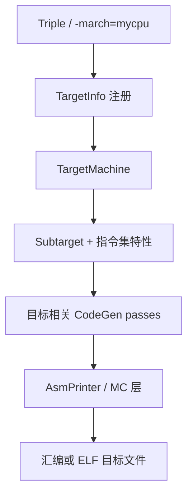

常见入口包括：

- `MyCPU.td` 声明目标、寄存器、指令和处理器模型；
- `MyCPUTargetMachine.cpp` 创建 `TargetMachine`；
- `MyCPUSubtarget.cpp` 解析 `-mcpu`、`-mattr`；
- `TargetInfo` 注册目标名称和初始化函数；
- CMake 文件把 TableGen 生成文件和 C++ 源文件加入构建。

最初可以先支持：

```text
llc -mtriple=mycpu-unknown-elf test.ll -o test.s
```

等汇编和目标文件稳定后，再接入 Clang 的 `-target mycpu-unknown-elf`。

## 5. 用 TableGen 描述寄存器和指令

### 5.1 寄存器定义

后端需要告诉 LLVM：

- 寄存器名称；
- 编码编号；
- 寄存器别名；
- 子寄存器和超寄存器；
- 寄存器类；
- 保留寄存器；
- 调用约定下的 caller-saved 和 callee-saved 寄存器。

示意代码如下：

```tablegen
// 仅用于说明结构，不能直接复制到任意后端
class MyCPUReg<bits<5> Enc, string N> : Register<N> {
  let HWEncoding = Enc;
  let Namespace = "MyCPU";
}

def R0 : MyCPUReg<0, "r0">;
def R1 : MyCPUReg<1, "r1">;
def R2 : MyCPUReg<2, "r2">;

def GPR : RegisterClass<"MyCPU", [i32], 32, (add R0, R1, R2)>;
```

真正的后端通常会使用已有的 `Register`、`RegisterClass`、寄存器元组和 TableGen 继承类。

### 5.2 指令定义

一条指令至少需要描述：

- 输入和输出操作数；
- 操作数所属寄存器类；
- opcode 编码；
- 汇编语法；
- 指令大小和对齐；
- 是否读写内存；
- 是否改变控制流；
- 调度延迟和资源使用；
- 与 LLVM DAG 或 GlobalISel 的匹配关系。

示意代码：

```tablegen
// 仅表示概念
class MyCPUInst<dag outs, dag ins, string asmstr, list<dag> patterns>
    : Instruction {
  let OutOperandList = outs;
  let InOperandList = ins;
  let AsmString = asmstr;
  let Pattern = patterns;
}

def MY_ADD : MyCPUInst<
    (outs GPR:$rd),
    (ins GPR:$rs1, GPR:$rs2),
    "my.add $rd, $rs1, $rs2",
    [(set GPR:$rd, (add GPR:$rs1, GPR:$rs2))]>;
```

实际后端会为不同编码格式建立自己的基类，例如寄存器-寄存器、寄存器-立即数、分支、load/store 等。

### 5.3 指令描述生成什么

TableGen 通常生成：

- opcode 枚举；
- `MCInstrDesc`；
- 操作数和约束信息；
- 编码器和解码器表；
- 汇编器匹配表；
- 调度模型数据；
- 寄存器和寄存器类信息。

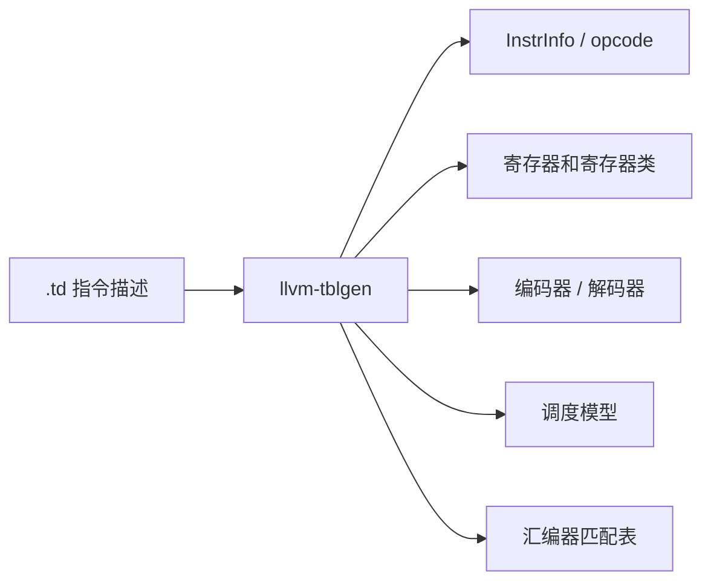

## 6. 让 LLVM IR 选择你的指令

定义了机器指令以后，还要让 LLVM 在合适的 IR 操作出现时选择它。

### 6.1 直接匹配标准 IR 操作

如果你的指令只是普通加法、乘法或比较，可以为标准 DAG 节点提供 pattern：

```text
(add x, y)  →  MY_ADD rd, x, y
```

这种方式适合指令语义与 LLVM 现有操作完全一致的情况。编译器可以在普通 C/C++ 代码中自动使用它。

需要注意：如果指令有特殊副作用、特殊舍入、特殊内存语义或不等价的异常行为，就不能简单伪装成普通 `add`。

### 6.2 使用 intrinsic 表达专用语义

如果指令没有对应的标准 LLVM IR 操作，通常定义 target intrinsic：

```text
C/C++ builtin 或显式 API
        ↓
LLVM intrinsic，例如 llvm.mycpu.special
        ↓
后端 lowering
        ↓
MY_SPECIAL 指令
```

Intrinsic 能表达：

- 特殊寄存器访问；
- 饱和运算；
- 特殊矩阵操作；
- 预取或缓存控制；
- 特殊同步；
- 硬件加速器操作。

Intrinsic 的定义通常涉及 `IntrinsicsMyCPU.td` 或目标后端已有的 intrinsic 文件。Clang 侧还需要 builtin 声明和 CodeGen 映射。

### 6.3 使用 inline asm 作为早期验证手段

在后端完整接入前，可以先用 inline asm 验证：

```c
static inline int my_add(int a, int b) {
  int result;
  __asm__("my.add %0, %1, %2" : "=r"(result) : "r"(a), "r"(b));
  return result;
}
```

这适合验证汇编器、硬件和 ABI 的基本约定。inline asm 不会自动让 LLVM 理解指令的内部语义，也不会给优化器提供完整的数据流信息，因此它适合作为原型阶段手段。

## 7. SelectionDAG 和 GlobalISel

### 7.1 SelectionDAG

SelectionDAG 把 LLVM IR 操作转换为带类型和链依赖的 DAG，再根据目标 pattern 选择机器指令。

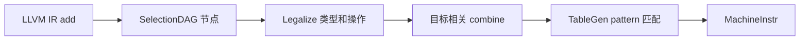

常见文件：

```text
MyCPUISelLowering.h/.cpp
MyCPUInstrInfo.td
MyCPUISelDAGToDAG.cpp
```

SelectionDAG 中常见的工作包括：

- 把目标不支持的类型拆分或扩展；
- 把函数调用转换成目标调用节点；
- 把全局地址转换成目标地址序列；
- 处理返回值和参数；
- 为特殊操作提供 custom lowering。

### 7.2 GlobalISel

GlobalISel 使用更通用的 Machine IR 逐步 lowering，通常需要实现：

- `LegalizerInfo`；
- `RegisterBankInfo`；
- `InstructionSelector`；
- call lowering；
- 部分 target-specific combine。

它更适合希望使用现代 Machine IR 流程的后端，但初学时可以先完整理解一个 SelectionDAG 目标，再对照 GlobalISel。

### 7.3 选择一条指令时要追踪什么

对一条自定义指令，可以沿着这条路径阅读：

```text
C/C++ 表达式
  ↓
LLVM IR 或 intrinsic
  ↓
ISel lowering
  ↓
MachineInstr opcode
  ↓
寄存器分配
  ↓
MCInst
  ↓
机器编码
```

如果只定义了 TableGen opcode，却没有 pattern、lowering 或 intrinsic，LLVM 不会主动生成这条指令。

## 8. 调用约定和栈帧

### 8.1 调用约定

后端需要定义函数调用如何降低：

```text
caller 参数
  ↓
寄存器或栈
  ↓
callee 读取参数
  ↓
返回值寄存器或内存
```

相关工作通常分布在：

- `MyCPUCallingConv.td`；
- `MyCPUISelLowering.cpp`；
- `TargetLowering::LowerFormalArguments`；
- `TargetLowering::LowerCall`；
- `TargetLowering::LowerReturn`。

### 8.2 栈帧和序言尾声

`FrameLowering` 负责：

- 创建和销毁栈帧；
- 保存 callee-saved 寄存器；
- 处理动态栈分配；
- 展开 frame index；
- 生成函数序言和尾声；
- 处理栈对齐和 red zone。

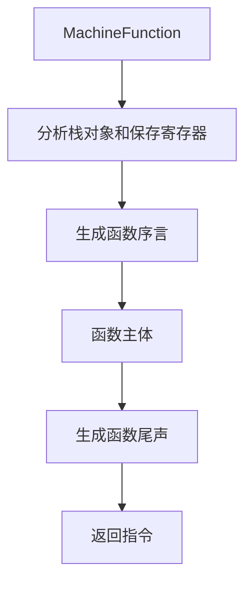

没有正确的栈帧实现，简单的叶子函数可能可以输出，但函数调用、局部变量、spill、调试和异常处理会出现问题。

## 9. 指令编码、汇编器和反汇编器

### 9.1 MC 层的职责

MC 层把 MachineInstr 转成汇编或二进制编码：

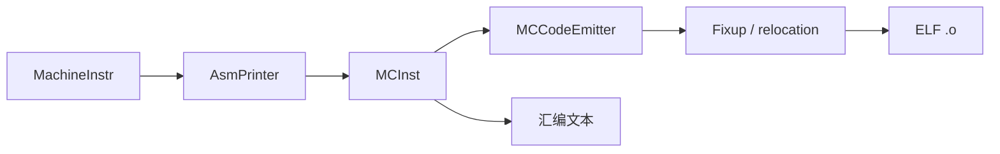

常见文件包括：

- `MCTargetDesc`：目标描述和初始化；
- `MyCPUCodeEmitter.cpp`：指令编码；
- `MyCPUAsmBackend.cpp`：fixup、重定位和汇编对象写出；
- `MyCPUInstPrinter.cpp`：机器指令打印成汇编；
- `MyCPUELFObjectWriter.cpp`：ELF relocation 映射；
- `AsmParser`：汇编文本解析；
- `Disassembler`：机器码反汇编。

### 9.2 为什么汇编器和后端要同时设计

如果 LLVM 能生成：

```asm
my.add r1, r2, r3
```

但 `llvm-mc` 不能解析它，测试和调试会很困难。如果编码器和解码器不一致，`llvm-objdump` 也无法可靠反汇编生成的目标文件。

建议至少建立这组闭环测试：

```bash
llvm-mc -triple=mycpu-unknown-elf -show-encoding test.s
llvm-mc -triple=mycpu-unknown-elf -filetype=obj test.s -o test.o
llvm-objdump -d test.o
llvm-readobj -r test.o
```

## 10. Linux ELF、LLD 和运行时支持

### 10.1 只生成汇编与生成可执行文件的差别

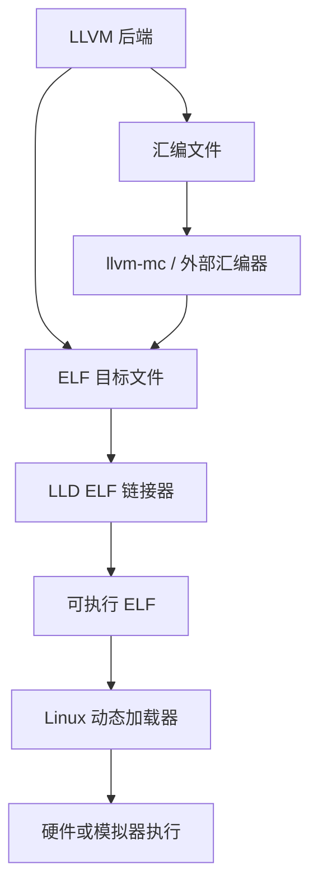

如果目标没有 Linux 内核、动态加载器和 C 库支持，可以先生成 ELF 目标文件供模拟器使用。此时可以使用 `unknown-elf` 风格的 triple，并使用裸机运行时或自定义启动代码。

如果希望编译 Linux 用户程序，则还要完成：

- ELF machine 类型和 ABI；
- `crt1.o`、libc、libgcc/compiler-rt 等启动和运行时文件；
- LLD 的目标相关 relocation、GOT/PLT、TLS 和 program header 支持；
- Linux 动态加载器对该架构的支持；
- 调试器、信号处理和系统调用约定。

### 10.2 修改 LLD 的时机

以下情况通常需要扩展 `lld/ELF`：

- 新增 ELF relocation 类型；
- 新增 GOT/PLT 或 TLS 规则；
- 新增 thunk 或分支范围处理；
- 新增 ELF machine 标识；
- 修改 ABI 中的 section、segment 或动态标签。

如果只是增加一条不改变 ABI 的算术指令，通常只需要 LLVM 后端和汇编器。只要指令参与函数调用、地址生成、分支范围或动态链接，就可能需要同步修改 LLD 和运行时。

## 11. 如果是在 RISC-V 上增加自定义指令

这是最常见、也最适合入门的路线。

### 11.1 定义扩展特性

通常给自定义扩展一个 feature 名称，例如：

```text
+Xmyext
```

然后让目标 triple 和 `-march` 能够启用它：

```bash
llc -mtriple=riscv64-unknown-elf -mattr=+xmyext input.ll -o output.s
```

后端需要让指令选择、汇编器和编码器都检查这个 feature。没有启用 feature 时，汇编器和后端应拒绝或跳过这些指令。

### 11.2 添加指令描述

在 RISC-V 后端中，通常需要修改或新增：

```text
llvm/lib/Target/RISCV/RISCVInstrInfo.td
llvm/lib/Target/RISCV/RISCVFeatures.td
llvm/lib/Target/RISCV/RISCVInstrInfo.cpp
llvm/lib/Target/RISCV/MCTargetDesc/
```

如果是标准 RISC-V 的 custom opcode，编码可以复用已有的 R-type、I-type 等格式。指令的 funct、opcode、寄存器类和汇编语法需要与硬件编码一致。

### 11.3 让 C/C++ 显式使用

如果指令是特殊语义，建议使用：

```text
C/C++ builtin
  ↓
LLVM intrinsic
  ↓
RISC-V custom instruction
```

如果只是临时验证，可以先用 inline asm。后端稳定后，再把 builtin、intrinsic、约束和优化语义补齐。

## 12. 自定义指令集的最小实现路线

建议按里程碑推进，不要一开始同时实现所有优化和 Linux 运行时。

```mermaid
flowchart TD
  spec["确定 ISA 编码和 ABI"] --> target["注册目标和 TargetMachine"]
  target --> regs["实现寄存器和寄存器类"]
  regs --> inst["实现一条整数指令"]
  inst --> select["让 LLVM IR 或 intrinsic 选择它"]
  select --> asm["实现汇编输出和编码"]
  asm --> obj["生成 ELF .o"]
  obj --> call["实现调用约定和栈帧"]
  call --> link["接入 LLD / 完成 ABI"]
  link --> opt["加入调度、寄存器分配和优化"]
```

### 阶段一：只生成一条指令

先实现：

- 一个目标 triple；
- 一个寄存器类；
- 一条无内存副作用的整数指令；
- 一个最小的指令选择 pattern；
- 汇编打印和机器编码。

目标是让下面的命令产生预期汇编：

```bash
llc -mtriple=mycpu-unknown-elf test.ll -o test.s
```

### 阶段二：加入汇编器和反汇编器

确保下面的往返成立：

```text
汇编文本
  ↓ assemble
机器编码
  ↓ disassemble
汇编文本
```

### 阶段三：加入调用约定和栈帧

实现函数参数、返回值、保存寄存器、局部变量和 spill。只有这一步稳定后，多个函数之间的 C 代码调用才可靠。

### 阶段四：加入访存和控制流

实现：

- load/store；
- 地址合法化；
- 条件分支；
- 跳转范围；
- 函数调用和返回；
- 全局地址和常量池。

### 阶段五：接入 ELF 和 LLD

实现目标文件、静态 relocation、链接器布局和必要的动态 relocation。此时才进入“生成可以被 Linux loader 执行的程序”的范围。

### 阶段六：加入性能优化

最后再实现：

- 调度模型；
- 目标相关 combine；
- 机器 peephole；
- post-RA 调度；
- 向量指令选择；
- 指令压缩；
- 分支和 thunk 优化。

## 13. 测试应该覆盖哪些层次

### TableGen 和后端测试

使用 LLVM 的 `lit` 和 `FileCheck`：

```text
LLVM IR → llc → 汇编
检查是否出现 my.add
检查是否没有错误的 load/store
检查寄存器和调用约定
```

### 汇编器测试

```bash
llvm-mc -triple=mycpu-unknown-elf test.s -show-encoding
```

检查：

- 合法操作数能编码；
- 非法寄存器会报错；
- feature 未启用时指令被拒绝；
- 编码与预期 bit pattern 一致。

### 目标文件测试

```bash
llvm-mc -triple=mycpu-unknown-elf -filetype=obj test.s -o test.o
llvm-readobj -h -S -r test.o
```

检查 ELF header、section、symbol 和 relocation。

### 代码生成测试

```bash
llc -mtriple=mycpu-unknown-elf test.ll -o -
```

检查：

- 指令选择；
- 寄存器分配；
- 栈帧；
- 分支和调用；
- 指令顺序；
- spill 和 reload。

### 端到端测试

当模拟器或硬件可用后，再测试：

```text
C/C++ → Clang → LLVM IR → LLVM 后端 → ELF → LLD → 模拟器/硬件
```

## 14. 初学者最容易走错的地方

### 只定义 opcode，却没有选择路径

TableGen 中出现一条指令，不等于 LLVM 会自动使用它。还需要标准 IR pattern、intrinsic lowering 或 GlobalISel selector。

### 先做复杂优化，再验证编码

应该先确认一条指令能从 MachineInstr 正确变成汇编和机器编码，再增加调度和寄存器分配优化。

### 忽略 ABI

单个函数的汇编看起来正确，不代表两个函数可以正确调用。参数寄存器、返回值、栈对齐和 callee-saved 规则必须先固定。

### 把 inline asm 当成完整后端

inline asm 可以验证硬件指令和 ABI，但优化器不会理解它的完整数据流、延迟和寄存器约束。长期使用仍需要真正的目标指令描述。

### 只测试汇编文本

最终还要测试编码、解码、ELF relocation、链接、调试信息和实际执行。错误可能出现在汇编打印正确但机器编码错误的阶段。

## 15. 具体例子

### 例子一：先用 inline asm 验证一条 RISC-V 自定义指令

假设硬件增加一条 `my.add`：

```text
my.add rd, rs1, rs2
结果 = rs1 + rs2
编码格式 = R-type
opcode = CUSTOM_0（0b0001011）
funct3 = 0
funct7 = 0
```

在 LLVM 后端完成之前，可以先用 RISC-V 的 `.insn` 伪指令验证编码和硬件行为：

```c
#include <stdint.h>

static inline uint64_t my_add(uint64_t a, uint64_t b) {
  uint64_t result;
  __asm__ volatile(
      ".insn r 0x0b, 0, 0, %0, %1, %2"
      : "=r"(result)
      : "r"(a), "r"(b));
  return result;
}
```

这里的 `0x0b` 是 RISC-V `CUSTOM_0` opcode。测试汇编和编码：

```bash
clang --target=riscv64-unknown-elf -S test.c -o test.s
llvm-mc -triple=riscv64 -show-encoding test.s
llvm-mc -triple=riscv64 -filetype=obj test.s -o test.o
llvm-objdump -d test.o
```

这个例子可以验证三件事：

- 硬件或模拟器是否执行了预期语义；
- `.insn` 写出的 bit pattern 是否正确；
- ABI 中的输入和输出寄存器是否符合预期。

此时 LLVM 仍然把这条指令当作一段 inline asm。优化器不会把它识别成普通加法，也不会自动把其他加法改写成 `my.add`。

### 例子二：在 RISC-V TableGen 中定义 `MY_ADD`

LLVM 当前 RISC-V 后端已经定义了 `RVInstR` 和 `OPC_CUSTOM_0`。真实代码可以参考 `llvm/lib/Target/RISCV/RISCVInstrInfoXTHead.td`。

扩展 feature 可以写成下面的结构：

```tablegen
// 结构接近当前 RISC-V 后端，名称和 feature 字段需要按版本调整
def FeatureVendorXMyExt
    : RISCVExtension<1, 0, "My custom integer instructions">;

def HasVendorXMyExt
    : Predicate<"Subtarget->hasVendorXMyExt()">,
      AssemblerPredicate<(all_of FeatureVendorXMyExt),
                         "'XMyExt' custom extension">;
```

然后使用 R-type 格式和 `CUSTOM_0` opcode：

```tablegen
let Predicates = [HasVendorXMyExt],
    hasSideEffects = 0,
    mayLoad = 0,
    mayStore = 0,
    isCommutable = 1 in

def MY_ADD : RVInstR<
    0b0000000,                 // funct7
    0b000,                     // funct3
    OPC_CUSTOM_0,
    (outs GPR:$rd),
    (ins GPR:$rs1, GPR:$rs2),
    "my.add",
    "$rd, $rs1, $rs2">;
```

这个定义告诉 TableGen：

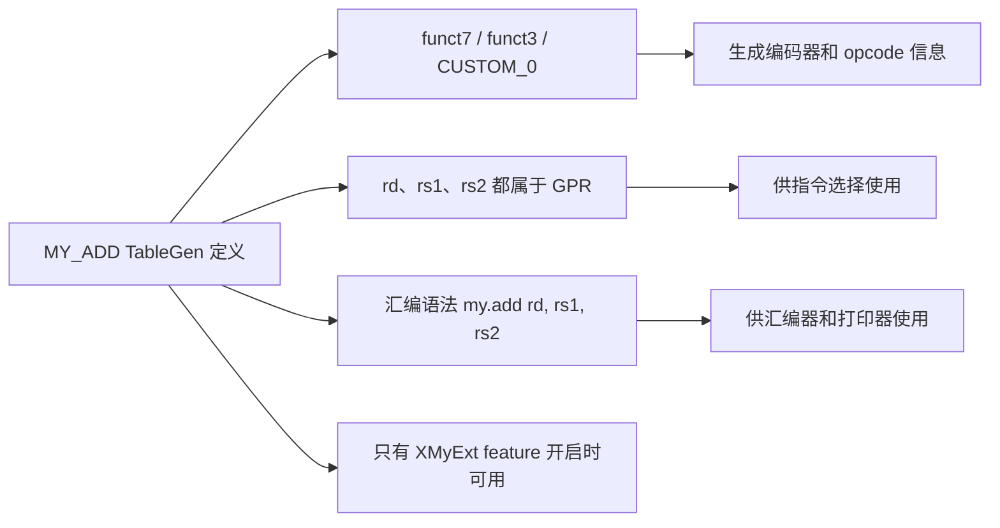

接下来还要提供 LLVM IR 到 `MY_ADD` 的选择关系。语义与普通整数加法完全相同，可以使用 pattern。下面是概念写法，具体输出操作数写法要以当前 RISC-V 指令类为准：

```tablegen
// 概念示意：普通 add 可以被选择成 MY_ADD
// 真实后端中通常会把 pattern 放入指令定义或单独的 Pat 定义
[(set GPR:$rd, (add GPR:$rs1, GPR:$rs2))]
```

如果 `my.add` 只是性能更好的普通加法，这种自动匹配是合理的。如果它具有特殊饱和、异常或状态寄存器语义，就应该使用 intrinsic，避免错误地把它当成普通 `add`。

### 例子三：用 intrinsic 显式调用专用指令

假设硬件指令执行的是“饱和加法”，它不能等价于 LLVM 的普通 `add`。可以设计一个 target intrinsic：

```llvm
; 这是 IR 形态示意
; 输入是两个 i32，输出是一个 i32

declare i32 @llvm.mycpu.sat.add.i32(i32, i32)

define i32 @sat_add(i32 %a, i32 %b) {
entry:
  %r = call i32 @llvm.mycpu.sat.add.i32(i32 %a, i32 %b)
  ret i32 %r
}
```

后端的处理链是：

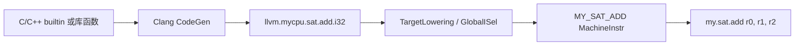

这个方案可以让 LLVM 保留专用语义，并控制：

- 该指令是否有副作用；
- 是否允许公共子表达式消除；
- 是否可以移动到其他基本块；
- 是否读写内存或特殊寄存器；
- 是否需要特定 target feature。

### 例子四：从 LLVM IR 追到最终汇编

准备一个最小 LLVM IR：

```llvm
define i32 @add2(i32 %a, i32 %b) {
entry:
  %sum = add i32 %a, %b
  ret i32 %sum
}
```

如果 `MY_ADD` 与普通 `add` 等价，期望的后端变化是：

```text
LLVM IR:
  %sum = add i32 %a, %b

指令选择后的 Machine IR：
  %vreg3 = MY_ADD %vreg1, %vreg2

寄存器分配后：
  MY_ADD r0, r0, r1

最终汇编：
  my.add r0, r0, r1
```

调试时可以分阶段观察：

```bash
llc -mtriple=mycpu-unknown-elf add.ll -o add.s
llc -mtriple=mycpu-unknown-elf -stop-after=instruction-select add.ll -o add.mir
llc -mtriple=mycpu-unknown-elf -print-before=greedy -print-after=greedy add.ll -o /dev/null
```

如果最终没有出现 `my.add`，按下面的顺序排查：

```text
1. 目标 triple 是否选择了正确后端
2. XMyExt feature 是否开启
3. TableGen 是否生成了 MY_ADD opcode
4. pattern 或 intrinsic lowering 是否匹配
5. 指令是否被寄存器类和操作数约束拒绝
6. AsmPrinter 是否能打印 MY_ADD
```

### 例子五：一个全新 MyCPU 后端最小闭环

假设设计一种只有 4 个 32 位通用寄存器的教学 CPU：

```text
r0、r1、r2、r3
add rd, rs1, rs2
sub rd, rs1, rs2
load rd, [rs1 + imm]
store rs2, [rs1 + imm]
ret
```

可以先只实现 `add`：

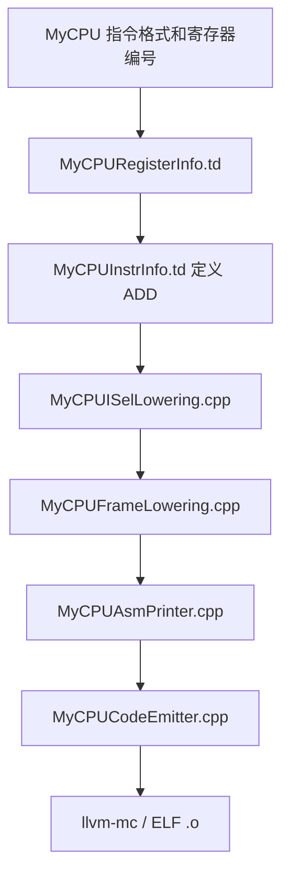

最小输入 IR：

```llvm
define i32 @add2(i32 %a, i32 %b) {
entry:
  %r = add i32 %a, %b
  ret i32 %r
}
```

预期汇编可以是：

```asm
add r0, r0, r1
ret
```

第一阶段只需要证明：

```text
IR add
  → MYCPU ADD MachineInstr
  → r0/r1 寄存器约束
  → add 编码
  → llvm-mc 可以反汇编回来
```

等 `add` 的闭环稳定以后，再增加 `load/store`、分支、调用约定和栈帧。这样每增加一种能力，都有一个可以单独验证的范围。

### 例子六：什么时候必须修改 LLD

假设 `my.add` 是普通寄存器运算：

```text
add r0, r1, r2
```

它不引用符号，不生成地址，也不改变调用约定。通常只涉及 LLVM 后端和 MC 层。

假设新增一条跳转指令：

```text
my.j target
```

而它只能编码 20 位 PC-relative 位移。此时需要考虑：

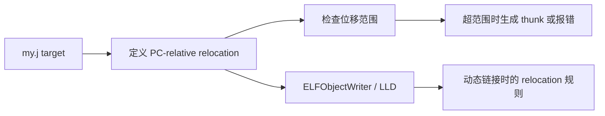

如果这条跳转还需要共享库、GOT、PLT 或动态加载器支持，工作范围就会扩展到：

- `MCTargetDesc` 的 fixup 和 ELF relocation；
- `lld/ELF/Target.cpp` 的目标相关处理；
- LLD 的 GOT/PLT 或 thunk 生成；
- Linux loader 的动态 relocation；
- 调试器和反汇编器的支持。

### 例子七：推荐的实际学习项目

可以按下面的项目顺序练习：

| 项目 | 目标 | 主要学习内容 |
|---|---|---|
| 项目 A | 给 RISC-V 加 `my.add` | `RVInstR`、`CUSTOM_0`、MC 编码 |
| 项目 B | 给 `my.add` 增加 `+XMyExt` feature | Subtarget、汇编器特性检查 |
| 项目 C | 用 intrinsic 调用饱和加法 | Clang builtin、LLVM intrinsic、lowering |
| 项目 D | 给自定义跳转加入 relocation | fixup、ELF relocation、LLD |
| 项目 E | 实现 4 寄存器 MyCPU | TargetMachine、寄存器分配、FrameLowering |
| 项目 F | 实现 Linux ELF 可执行文件 | ABI、启动文件、LLD、动态加载器 |

对于初学者，项目 A 到项目 C 已经能覆盖“指令描述、选择和编码”的核心路径。项目 D 以后才进入链接器和运行时系统的范围。

## 16. 一个可照着修改的 RISC-V 最小项目

下面假设你要给当前 LLVM 的 RISC-V 后端增加 `my.add`。它使用 R-type 编码，语义等同于普通整数加法：

```text
my.add rd, rs1, rs2
opcode = CUSTOM_0
funct3 = 0
funct7 = 0
```

### 16.1 先确定修改文件

最小项目通常涉及这些文件：

```text
llvm/lib/Target/RISCV/RISCVFeatures.td
llvm/lib/Target/RISCV/RISCVInstrInfoXMyExt.td
llvm/lib/Target/RISCV/RISCVInstrInfo.td

llvm/test/MC/RISCV/myext-valid.s
llvm/test/MC/RISCV/myext-invalid.s
llvm/test/CodeGen/RISCV/myext-myadd.ll
```

如果只增加 TableGen 文件并由 `RISCVInstrInfo.td` include，通常不需要立刻修改 C++。如果需要新的 lowering、intrinsic 或 ABI，再增加 `RISCVISelLowering.cpp`、Subtarget、Clang builtin 等文件。

### 16.2 增加 feature

在 `RISCVFeatures.td` 中增加一个 vendor extension：

```tablegen
def FeatureVendorXMyExt
    : RISCVExtension<1, 0, "My custom integer instructions">;

def HasVendorXMyExt
    : Predicate<"Subtarget->hasVendorXMyExt()">,
      AssemblerPredicate<(all_of FeatureVendorXMyExt),
                         "'XMyExt' custom extension">;
```

`RISCVExtension` 会根据 record 名称生成扩展名和 Subtarget 字段。这里的目标是让下面的选项能打开该 feature：

```bash
-mattr=+xmyext
```

在实际 LLVM 版本中，vendor extension 的命名和 `-march` 解析还要经过 RISC-V ISA parser。先用 `-mattr=+xmyext` 做后端测试，确认 feature 能被识别后，再决定是否把它完整接入 `-march=rv64im_xmyext`。

### 16.3 新建指令文件并 include

创建 `RISCVInstrInfoXMyExt.td`：

```tablegen
let Predicates = [HasVendorXMyExt],
    hasSideEffects = 0,
    mayLoad = 0,
    mayStore = 0,
    isCommutable = 1 in

def MY_ADD : RVInstR<
    0b0000000,
    0b000,
    OPC_CUSTOM_0,
    (outs GPR:$rd),
    (ins GPR:$rs1, GPR:$rs2),
    "my.add",
    "$rd, $rs1, $rs2">;
```

然后在 `RISCVInstrInfo.td` 的扩展 include 区域加入：

```tablegen
include "RISCVInstrInfoXMyExt.td"
```

当前仓库中的 `RISCVInstrInfo.td` 在文件后部 include 了 `RISCVInstrInfoXTHead.td`、`RISCVInstrInfoXCV.td` 等 vendor extension 文件，可以把它们作为结构参考。

### 16.4 让普通 `add` 选择 `MY_ADD`

当前 RISC-V 后端已经提供 `PatGprGpr` 辅助模板。因为 `my.add` 与普通 `add` 语义完全相同，可以加入：

```tablegen
let Predicates = [HasVendorXMyExt] in {
  def : PatGprGpr<add, MY_ADD>;
}
```

这表示：

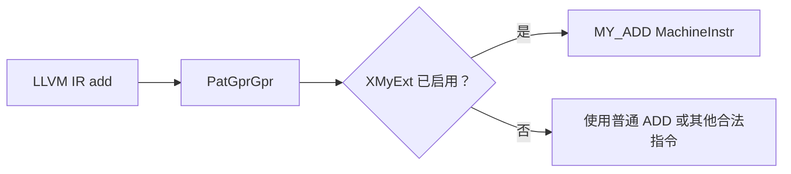

如果你不希望普通 C/C++ 加法自动变成自定义指令，就不要添加这个 pattern。此时应该通过 intrinsic 或 inline asm 显式使用 `MY_ADD`。

### 16.5 添加 MC 汇编测试

创建 `llvm/test/MC/RISCV/myext-valid.s`：

```asm
# RUN: llvm-mc -triple=riscv64 -mattr=+xmyext \
# RUN:   -show-encoding %s | FileCheck %s

my.add a0, a1, a2

# CHECK: my.add a0, a1, a2
# CHECK-SAME: encoding: [0x0b, 0x85, 0xc5, 0x00]
```

这里使用：

```text
rd  = a0 = 10
rs1 = a1 = 11
rs2 = a2 = 12
opcode = 0x0b
funct3 = 0
funct7 = 0
```

对应的 R-type 编码计算为：

```text
(funct7 << 25) | (rs2 << 20) | (rs1 << 15)
| (funct3 << 12) | (rd << 7) | opcode
= 0x00c5850b
```

RISC-V 使用小端字节序写入目标文件，所以 `llvm-mc` 输出的字节顺序是：

```text
[0x0b, 0x85, 0xc5, 0x00]
```

创建非法指令测试 `llvm/test/MC/RISCV/myext-invalid.s`：

```asm
# RUN: not llvm-mc -triple=riscv64 -mattr=-xmyext %s 2>&1 \
# RUN:   | FileCheck %s --check-prefix=CHECK-NO-FEATURE

my.add a0, a1, a2

# CHECK-NO-FEATURE: instruction requires the following:
```

错误文本可能随 LLVM 版本变化，测试时应以当前 `llvm-mc` 的实际诊断为准。

### 16.6 添加 CodeGen 测试

创建 `llvm/test/CodeGen/RISCV/myext-myadd.ll`：

```llvm
; RUN: llc -mtriple=riscv64 -mattr=+xmyext %s -o - \
; RUN:   | FileCheck %s

; CHECK-LABEL: add2:
; CHECK:       my.add a0, a0, a1
; CHECK-NEXT:  ret

define i64 @add2(i64 %a, i64 %b) {
entry:
  %sum = add i64 %a, %b
  ret i64 %sum
}
```

这条测试依赖调用约定把两个参数放到 `a0` 和 `a1`，返回值放到 `a0`。如果你的目标使用其他 ABI，应按目标调用约定修改检查行。

### 16.7 运行测试

在 LLVM 构建目录中运行：

```bash
ninja llvm-tblgen llc llvm-mc llvm-objdump
ninja check-llvm-codegen-riscv
ninja check-llvm-mc-riscv
```

也可以先单独运行单个 lit 测试：

```bash
llvm-lit -v llvm/test/MC/RISCV/myext-valid.s
llvm-lit -v llvm/test/CodeGen/RISCV/myext-myadd.ll
```

如果没有配置 `llvm-lit`，可以直接运行生成的工具：

```bash
llvm-mc -triple=riscv64 -mattr=+xmyext -show-encoding myext-valid.s
llc -mtriple=riscv64 -mattr=+xmyext myext-myadd.ll -o -
```

### 16.8 根据现象定位问题

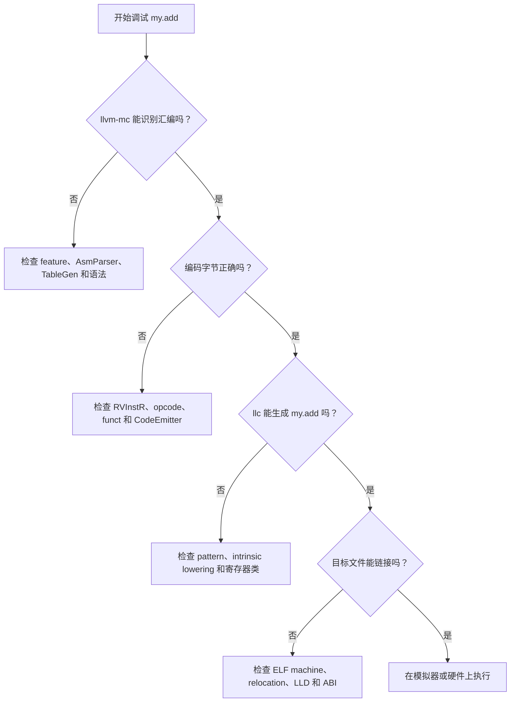

对应关系可以压缩成一句话：

```text
汇编失败       → MC parser / feature / TableGen
编码错误       → 指令格式 / opcode / CodeEmitter
llc 不选择     → pattern / lowering / 寄存器约束
链接失败       → ELF relocation / LLD / ABI
运行错误       → 硬件编码 / 调用约定 / 运行时环境
```

### 16.9 这个例子还缺少什么

上面的 `my.add` 是最简单的无内存、副作用整数指令。它还没有涉及：

- 自定义 intrinsic；
- Clang builtin；
- load/store；
- 分支和跳转范围；
- 调度延迟和资源模型；
- 寄存器分配约束；
- ELF relocation；
- LLD 和 Linux 动态加载器。

每增加一种新能力，都应先增加一个能单独失败和单独验证的 MC 或 CodeGen 测试。

## 源码速查表

| 目标 | 推荐阅读位置 |
|---|---|
| 目标注册 | `llvm/lib/Target/<Target>/TargetInfo` |
| TargetMachine | `llvm/lib/Target/<Target>/*TargetMachine*` |
| 寄存器 | `*RegisterInfo.td`、`*RegisterInfo.cpp` |
| 指令定义 | `*InstrInfo.td`、`*InstrInfo.cpp` |
| 指令选择 | `*ISelLowering.cpp`、`*ISelDAGToDAG.cpp`、GlobalISel 文件 |
| 调用约定 | `*CallingConv.td`、`LowerFormalArguments`、`LowerCall` |
| 栈帧 | `*FrameLowering.cpp` |
| 调度模型 | `*Schedule.td`、`*Sched*.td` |
| 汇编输出 | `*AsmPrinter.cpp` |
| 指令编码 | `MCTargetDesc/*CodeEmitter.cpp` |
| 汇编器 | `AsmParser`、`MCTargetDesc` |
| 反汇编器 | `Disassembler` |
| ELF relocation | `*ELFObjectWriter.cpp`、`*FixupKinds.h` |
| LLD 目标支持 | `lld/ELF/Target.cpp` 及目标相关文件 |
| 测试 | `llvm/test/CodeGen/<Target>`、`llvm/test/MC/<Target>` |

真正开始实现时，优先选择一个已有后端作为模板，先完成“一个寄存器类、一条整数指令、一个汇编器往返测试和一个 `llc` 输出测试”。这条闭环稳定后，再扩展到调用约定、访存、重定位和 Linux 运行时。

## 17. 这些工作都属于编译器后端吗

不完全属于。LLVM 把编译过程分成前端、中端和后端，边界是按“输入和目标依赖程度”理解的。

| 工作 | 常见所在层 | 是否依赖具体 CPU | 典型 LLVM 位置 |
|---|---|---:|---|
| 词法、语法和类型检查 | 前端 | 否 | Clang |
| 生成 LLVM IR | 前端 | 少量 | `clang/lib/CodeGen` |
| IR 变换和大多数 IR Pass | 中端 | 通常否 | `llvm/lib/Transforms` |
| 目标相关 IR 优化 | 中端和后端交界 | 是 | `llvm/lib/Target/<Target>` |
| 指令选择 | 后端 | 是 | `ISelLowering`、GlobalISel |
| Machine IR Pass | 后端 | 是 | `llvm/lib/CodeGen`、目标后端 |
| 指令调度 | 后端 | 是 | `MachineScheduler`、调度模型 |
| 寄存器分配 | 后端 | 是 | `RegAlloc`、寄存器类和约束 |
| 栈帧和调用约定 | 后端 | 是 | `FrameLowering`、`CallingConv` |
| 机器指令编码和 ELF 输出 | 后端 MC 层 | 是 | `MCTargetDesc` |
| 链接和重定位布局 | 链接器 | 是 | LLD |

最容易混淆的是“IR 变换”。`mem2reg`、GVN、循环优化这类 Pass 作用于目标无关的 LLVM IR，属于中端。把一个 IR 操作改成某个目标 intrinsic，或者根据目标 CPU 的特性改变 IR，属于目标相关优化，通常放在后端或中端与后端的交界处。

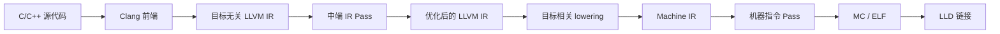

因此，IR 变换、Pass 优化、指令调度、寄存器分配、访存优化和硬件指令生成属于同一个完整编译流程，但不属于同一层。

## 18. 从 IR 到硬件指令的完整示例

先看一个普通函数：

```c
int sum(int *p, int n) {
  int s = 0;
  for (int i = 0; i < n; ++i)
    s += p[i];
  return s;
}
```

它会经历多个不同层次。下面的 IR 只保留关键结构：

```llvm
%value = load i32, ptr %element_ptr, align 4
%next = add i32 %sum, %value
store i32 %next, ptr %sum_slot, align 4
```

### 18.1 IR Pass 先改变程序结构

`mem2reg` 可能把栈上的 `%sum_slot` 提升为 SSA 值。循环优化可能进行归纳变量简化、循环展开或向量化。此阶段的目标是减少无用操作、暴露并行性和改善数据流。

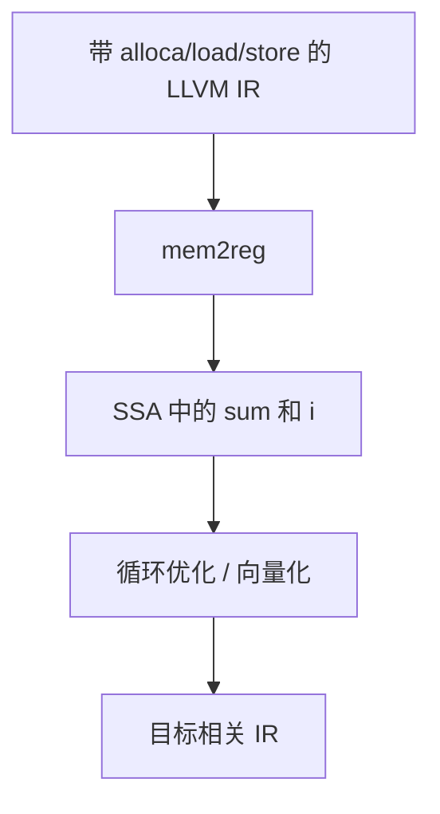

可以用 `opt` 观察单个 Pass 的作用：

```bash
opt -passes=mem2reg input.ll -S -o mem2reg.ll
opt -passes='default<O2>' input.ll -S -o o2.ll
```

这些 Pass 仍然没有决定使用哪个物理寄存器，也没有输出机器编码。

### 18.2 指令选择把 IR 操作变成 MachineInstr

对 RISC-V 来说，`load i32` 可能选择为 `lw`，`add i32` 可能选择为 `add`。如果启用了自定义扩展，也可能选择 `MY_ADD`。

```text
LLVM IR                 Machine IR
%x = add i32 %a, %b  →  %v3 = ADD %v1, %v2
%y = load i32 ...    →  %v4 = LW %v5, 0
```

此时 `%v1`、`%v2` 等是虚拟寄存器。它们代表“需要一个寄存器”，还没有确定是 `a0` 还是 `t0`。

### 18.3 指令调度改变顺序

调度器会在不改变可观察语义的前提下重排独立指令。例如，加载延迟较长时，可能先执行与加载无关的加法：

```text
原始顺序       load p[0]     →     add s, x
调度后         add s, x       →     load p[0]
```

真实调度必须遵守数据依赖、内存依赖、控制依赖和目标处理器的资源限制。调度模型描述延迟和执行资源，调度器据此选择较好的顺序。

### 18.4 寄存器分配绑定物理寄存器

寄存器分配器会把虚拟寄存器映射到目标寄存器。如果同时活跃的值太多，后端会把部分值 spill 到栈上，并插入 store/reload。

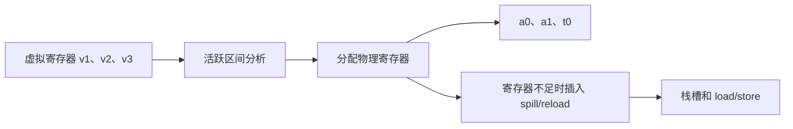

寄存器分配属于后端。它必须使用目标提供的寄存器类、别名、保留寄存器和调用约定信息。

### 18.5 访存优化分布在多个阶段

“访存优化”不是一个单独 Pass。它可能发生在多个层次：

| 层次 | 示例 | 主要依据 |
|---|---|---|
| LLVM IR | `mem2reg`、死存储删除、别名分析 | 指针、对齐、内存序 |
| 循环优化 | 循环交换、展开、向量化 | 依赖关系、访问步长 |
| 指令选择 | 选择带偏移寻址的 load/store | 目标寻址模式 |
| Machine IR | load/store 合并、机器 peephole | 具体 opcode 和寄存器 |
| 调度 | 避免 load-use 停顿 | 延迟和执行资源 |
| LLD/运行时 | GOT、PLT、TLS、段布局 | ELF ABI 和 Linux loader |

例如，`p[i]` 最终可能变成：

```asm
slli t0, a1, 2
add  t0, a0, t0
lw   t1, 0(t0)
```

如果目标支持更合适的寻址形式，指令选择可以减少地址计算。是否安全还要看地址溢出、对齐、别名和目标 ISA 约束。

### 18.6 硬件指令生成是最后一段链路

“生成硬件指令”包含多个步骤，不只是写一条汇编字符串：

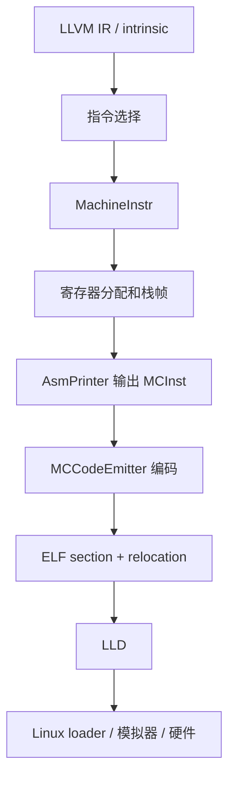

这条链路中，TableGen 主要描述指令、操作数、编码和约束。C++ lowering 决定何时产生目标操作，MC 层负责把目标操作编码成字节，LLD 负责跨目标文件解析符号和重定位。

## 19. 用调试选项观察每个阶段

针对一个后端问题，先确定它在哪个表示层消失。下面是一组常用观察方法：

```bash
# 查看 IR Pass 前后的文本
opt -passes='default<O2>' input.ll -S -o optimized.ll

# 查看指令选择后的 Machine IR
llc -mtriple=riscv64 -stop-after=instruction-select input.ll -o selected.mir

# 查看寄存器分配前后的 Machine IR
llc -mtriple=riscv64 -print-before=greedy \
  -print-after=greedy input.ll -o /dev/null

# 查看汇编和机器编码
llc -mtriple=riscv64 input.ll -o output.s
llvm-mc -triple=riscv64 -show-encoding output.s

# 查看 ELF 头、节和重定位
llvm-mc -triple=riscv64 -filetype=obj output.s -o output.o
llvm-readobj -h -S -r output.o
```

如果 IR 中已经有 intrinsic，但 `-stop-after=instruction-select` 的 MIR 没有对应 opcode，问题在 lowering 或 selector。如果 MIR 中有 opcode，但汇编没有正确打印，问题在 AsmPrinter 或 MC 描述。如果编码字节不正确，检查 `MCCodeEmitter`、opcode 字段和 fixup。

## 20. 自定义指令的选择策略

可以按语义选择三种接入方式：

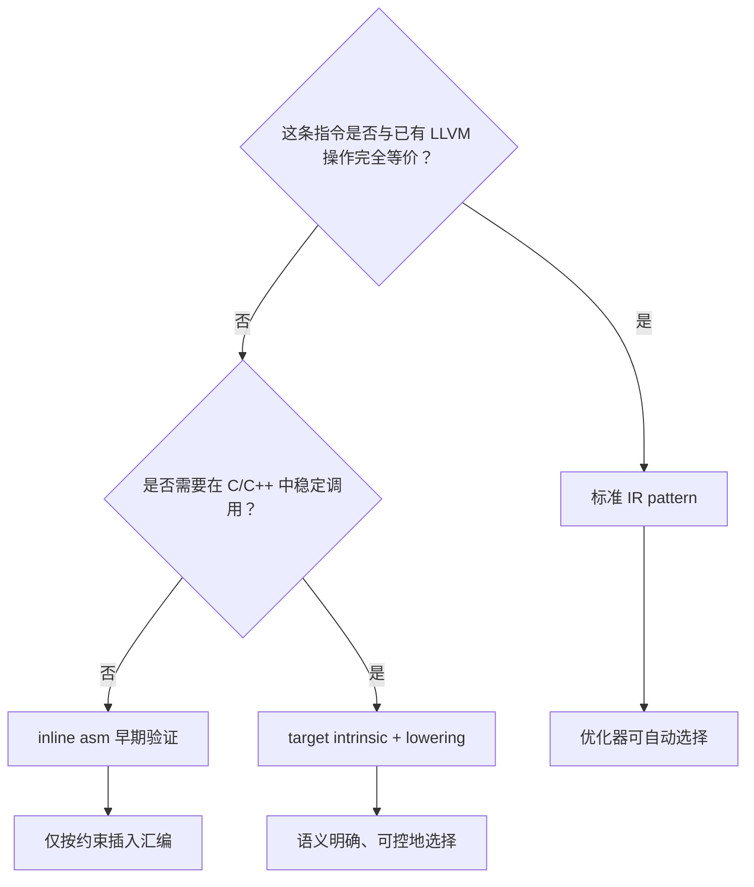

例如普通整数加法可以使用 pattern：

```tablegen
def : PatGprGpr<add, MY_ADD>;
```

饱和加法、矩阵乘、特殊状态寄存器访问则应使用 intrinsic。inline asm 适合确认编码和硬件行为，长期使用时应补充正式的指令描述和语义。

## 21. Linux-only 学习路线

可以按照下面的顺序在 Linux 主机上练习，先使用 RISC-V `unknown-elf` 目标生成和检查代码，再考虑 Linux 用户程序。

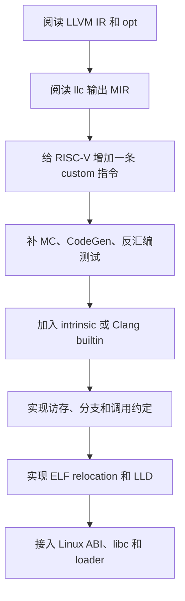

每一步都应保留一个最小输入和一个可重复命令。这样看到错误时，可以判断是 IR、Machine IR、汇编、ELF 还是运行时的问题。

### 21.1 一条命令链的最小检查

```bash
clang -S -emit-llvm -O0 add.c -o add.ll
opt -passes=mem2reg add.ll -S -o add.opt.ll
llc -mtriple=riscv64 -mattr=+xmyext add.opt.ll -o add.s
llvm-mc -triple=riscv64 -mattr=+xmyext -filetype=obj add.s -o add.o
llvm-readobj -h -S -r add.o
```

这组命令只检查 LLVM 产物和 ELF 目标文件。要运行 Linux 程序，还需要与目标架构匹配的交叉 libc、启动文件、链接器配置、Linux 内核支持和硬件或模拟器。

## 22. 术语速记

| 术语 | 初学者可以先这样理解 |
|---|---|
| IR | 与具体硬件无关的程序中间表示 |
| Pass | 对某种 IR 做一次分析或变换的组件 |
| Machine IR | 已经带有目标 opcode 和寄存器类的表示 |
| 指令选择 | 把通用操作变成目标指令 |
| 指令调度 | 在依赖允许的范围内安排机器指令顺序 |
| 寄存器分配 | 把虚拟寄存器映射到物理寄存器 |
| spill | 寄存器不足时把值暂存到栈上 |
| MC | 汇编、编码、解码和目标文件相关层 |
| fixup | 组装时暂时保留、由后续地址信息修正的字段 |
| relocation | ELF 中记录符号地址如何修正的条目 |
| ABI | 函数调用、数据布局和目标文件之间的约定 |
| intrinsic | LLVM 能识别的目标相关内建操作 |

## 23. 完成一个自定义指令前的检查清单

- [ ] 已确定指令语义、编码、寄存器和立即数约束。
- [ ] 已决定使用标准 IR pattern、intrinsic 还是 inline asm。
- [ ] 已声明目标 feature，并验证 feature 关闭时会拒绝指令。
- [ ] 已完成 TableGen 描述、汇编打印和机器编码。
- [ ] 已有 `llvm-mc` 编码测试和反汇编往返测试。
- [ ] 已有 `llc` CodeGen 测试，覆盖 feature 开启和关闭。
- [ ] 已检查寄存器类、调用约定和栈帧影响。
- [ ] 若涉及地址或符号，已设计 fixup、ELF relocation 和 LLD 行为。
- [ ] 已在模拟器或硬件上验证实际执行结果。
- [ ] 若目标是 Linux 用户程序，已准备 ABI、启动文件、libc 和动态加载器支持。

## 24. 两个更具体的后端例子

### 24.1 自定义访存指令为什么需要额外语义

假设硬件提供一条 `my.load.acquire`，它从内存读取一个字，并带有 acquire 内存序：

```asm
my.load.acquire a0, (a1)
```

它不能只按照普通 `load` 的形式匹配，因为 LLVM 还必须知道它的内存行为。一个目标指令描述至少需要表达：

```text
读内存             mayLoad = 1
不写内存           mayStore = 0
是否有额外副作用   hasSideEffects 按硬件定义
访问大小           i32 或 i64
对齐要求           由 MachineMemOperand 表达
内存序             acquire / monotonic / seq_cst
```

如果这条指令只支持 acquire，而 LLVM 选择器收到的是普通 relaxed load，就不能直接替换。可以使用 intrinsic 携带精确语义：

```llvm
declare i32 @llvm.mycpu.load.acquire.p0(ptr)

define i32 @read_flag(ptr %p) {
entry:
  %v = call i32 @llvm.mycpu.load.acquire.p0(ptr %p)
  ret i32 %v
}
```

```mermaid
flowchart LR
  intrinsic["llvm.mycpu.load.acquire"] --> lowering["目标 lowering"]
  lowering --> memmi["MY_LOAD_ACQUIRE MachineInstr"]
  memmi --> mmo["MachineMemOperand: load + acquire"]
  mmo --> sched["调度器保留内存依赖"]
  sched --> emit["my.load.acquire 编码"]
```

这个例子说明，访存指令的难点不只在 opcode。别名分析、内存序、对齐、异常和调度都可能改变正确性。

### 24.2 调度和寄存器分配的一个小例子

假设目标处理器的 `load` 延迟为 3 个周期，而加法延迟为 1 个周期：

```text
v1 = LOAD [p]       ; 结果到达较晚
v2 = ADD  x, y      ; 与 LOAD 无关
v3 = ADD  v1, z     ; 依赖 v1
```

调度器可以把独立的 `ADD x, y` 放到 `LOAD` 和使用 `v1` 之间：

```text
LOAD [p]
ADD  x, y
ADD  v1, z
```

它不能把最后一条 `ADD v1, z` 放到 `LOAD` 前面，因为那会违反数据依赖。调度模型通常在 `Sched` 或 `Schedule` TableGen 文件中描述延迟和资源。

寄存器分配发生在调度之后的后端流程中。假设只有两个可用寄存器：

```text
v1 = ADD a, b
v2 = ADD c, d
v3 = ADD v1, v2
```

如果 `v1` 和 `v2` 的活跃区间重叠，而物理寄存器数量不足，后端可能生成：

```asm
add  r0, r1, r2
store r0, 0(sp)      # spill v1
add  r0, r3, r4
load  r1, 0(sp)      # reload v1
add  r0, r1, r0
```

```mermaid
flowchart TD
  mi["带虚拟寄存器的 Machine IR"] --> sched["按依赖和延迟调度"]
  sched --> live["计算活跃区间"]
  live --> enough{"物理寄存器足够吗？"}
  enough -->|是| map["映射到物理寄存器"]
  enough -->|否| spill["插入 spill / reload"]
  spill --> map
  map --> final["可编码的 MachineInstr"]
```

因此，自定义指令如果要求特定寄存器，必须在 TableGen 或 C++ 约束中明确声明。否则寄存器分配器可能把操作数放入硬件不接受的寄存器，最终生成错误代码。

## 25. 如何从一个错误快速定位层次

下面的判断表适合调试自定义后端：

| 现象 | 首先查看 | 常见原因 |
|---|---|---|
| `opt` 后 IR 不符合预期 | IR Pass 和分析结果 | Pass 没有运行、属性或别名信息不正确 |
| `llc` 没有生成自定义 opcode | lowering、pattern、feature | pattern 未匹配、类型不合法、feature 未开启 |
| MIR 有 opcode，汇编缺失 | AsmPrinter、InstPrinter | opcode 没有打印规则或操作数格式错误 |
| 汇编能打印，`llvm-mc` 不能解析 | AsmParser、TableGen | 汇编语法或 feature predicate 不一致 |
| 编码字节错误 | CodeEmitter、指令字段 | opcode、funct、寄存器编码或端序错误 |
| `.o` 能生成但链接失败 | fixup、ELFObjectWriter、LLD | relocation 未定义、符号范围超限、ABI 不一致 |
| 程序能链接但运行错误 | 硬件、模拟器、ABI | 指令语义、调用约定、内存序或启动环境错误 |

```mermaid
flowchart TD
  error["发现错误"] --> ir{"IR 是否正确？"}
  ir -->|否| pass["检查 IR Pass 和前端生成"]
  ir -->|是| mir{"MIR 是否包含目标 opcode？"}
  mir -->|否| lower["检查 feature、pattern 和 lowering"]
  mir -->|是| asm{"汇编和编码是否正确？"}
  asm -->|否| mc["检查 InstPrinter、AsmParser、CodeEmitter"]
  asm -->|是| elf{"ELF 是否能链接？"}
  elf -->|否| reloc["检查 fixup、relocation、LLD、ABI"]
  elf -->|是| run["检查硬件或模拟器执行"]
```
