# LLD（Linux ELF）实现机制详解

> 适合读者：刚开始学习 LLVM、想弄清楚 Linux 程序如何从 `.o` 文件变成可执行文件的读者。
>
> 本文只讨论 Linux 上的 ELF 链接流程，源码重点是 `lld/ELF`。LLD 还包含 COFF、Mach-O、WebAssembly 等后端，本文不展开。
>
> 源码基线：`/home/cambricon/Documents/code/llvm-project` 的 `main` 分支（2026-11）。文中流程图使用 Mermaid，建议在支持 Mermaid 的 Markdown 阅读器中查看。

## 先看结论

编译器把每个源文件翻译成**可重定位目标文件**，链接器再把多个目标文件、静态库、共享库和运行时启动文件组合成一个 ELF 输出文件。

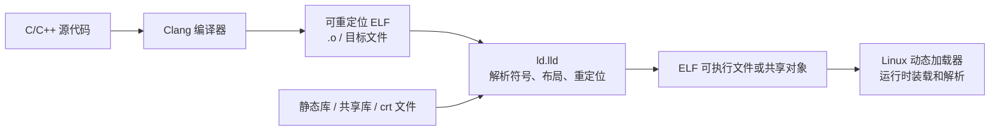

链接器最核心的三项工作是：

1. **符号解析**：每个未定义符号最终由哪个定义提供？
2. **地址布局**：每个输入 section 和输出 section 放到什么地址、什么文件偏移？
3. **重定位**：目标文件中暂时未知的地址或常量，最终应写成什么值？

可以把链接器理解成：

> **先建立“名字到实体”的关系，再决定实体在输出文件中的位置，最后把所有依赖地址的机器码和数据补齐。**

## 1. 先理解 Linux ELF 的几个对象

### 1.1 可重定位目标文件：`ET_REL`

编译但不链接时：

```bash
clang -c main.c -o main.o
```

`main.o` 通常是 ELF `ET_REL` 文件。它包含：

- `.text`：机器指令；
- `.rodata`：只读常量；
- `.data`：已初始化可写数据；
- `.bss`：未初始化数据，通常只记录大小；
- `.symtab` / `.strtab`：符号表和字符串表；
- `.rela.*` 或 `.rel.*`：重定位记录；
- `.debug_*`：调试信息（如果用 `-g` 编译）。

目标文件中的地址通常还没有最终意义。例如，`main.o` 中对另一个文件里 `foo` 的调用，只能先记录“这里需要一个针对 `foo` 的重定位”。

### 1.2 最终 ELF 文件：`ET_EXEC` 或 `ET_DYN`

常见输出有两类：

| 命令 | 输出 | 说明 |
|---|---|---|
| `ld.lld ... -o app` | `ET_EXEC` 或目标相关的可执行 ELF | 非 PIE 可执行文件 |
| `clang -fPIE -pie -fuse-ld=lld ...` | `ET_DYN` | PIE 可执行文件，通常可配合 ASLR |
| `ld.lld -shared ...` | `ET_DYN` | 共享对象 `.so` |
| `ld.lld -r ...` | `ET_REL` | 部分链接，仍输出可重定位文件 |

最终文件不仅有 section，还要有给 Linux loader 使用的 **program header / segment**。section 主要服务于链接器和调试工具；segment 描述运行时应如何映射内存。

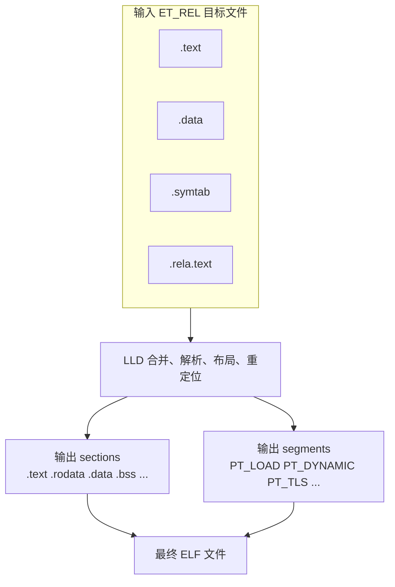

### 1.3 section 和 segment 不要混为一谈

一个输出 section 主要描述一类内容，例如 `.text`；一个 segment 描述一次运行时映射，例如可读可执行的 `PT_LOAD`。多个 section 可以放进同一个 segment：

```text
链接视角：  .text  .rodata  .data  .bss  .dynsym ...
                         │
                         ▼
运行时视角：PT_LOAD(RX)  PT_LOAD(R)  PT_LOAD(RW)  PT_DYNAMIC ...
```

LLD 的 `Writer` 会先完成 section 的内容和地址，再构造 program headers、文件偏移和最终输出。

## 2. `ld.lld` 是怎样启动的

### 2.1 `clang` 和 `ld.lld` 的分工

常见命令是：

```bash
clang -fuse-ld=lld main.o util.o -o app
```

这里真正负责链接的是 LLD，但 `clang` 这个 compiler driver 会先补充很多参数和文件，例如：

- `crt1.o`、`crti.o`、`crtn.o` 等启动文件；
- `-L` 库搜索路径；
- `-lc`、`-lm`、`libgcc` 或 compiler-rt 相关库；
- PIE、动态加载器路径和目标架构选项。

直接调用：

```bash
ld.lld main.o util.o -o app
```

此时 LLD 不会替你推断完整的 C 运行时链接命令；它主要按照收到的参数工作。Linux 应用通常优先使用 `clang -fuse-ld=lld`，直接调用 `ld.lld` 更适合学习和调试链接器本身。

### 2.2 LLD 的入口和 Linux ELF 分发

`lld/tools/lld/lld.cpp` 中的 `lld_main` 是总入口。它把 `argv[0]` 这样的程序名交给公共分发器：

- `ld.lld` 通常选择 GNU/ELF flavor；
- `lld/Common/DriverDispatcher.cpp` 根据程序名或 `-flavor` 选择具体 driver；
- Linux ELF 最终进入 `lld/ELF/Driver.cpp`。

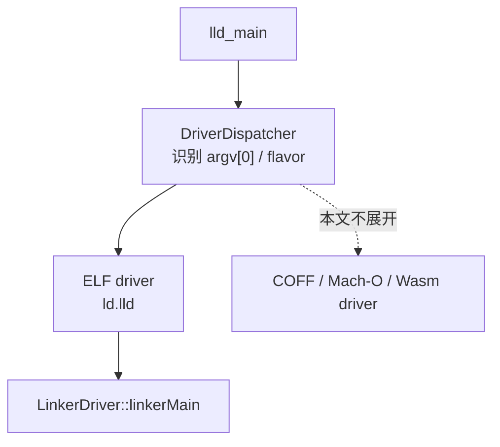

### 2.3 ELF driver 的总流程

`lld/ELF/Driver.cpp::LinkerDriver::linkerMain` 的主线可以概括为：

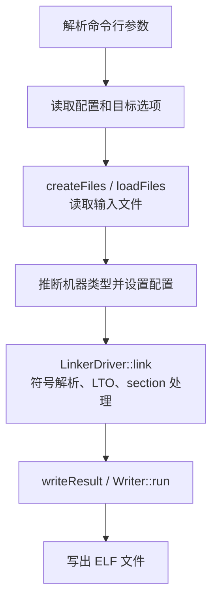

源码中大致对应：

1. `ELFOptTable::parse` 解析 `ld.lld` 参数；
2. `readConfigs`、`setConfigs` 设置输出类型、架构、动态链接等状态；
3. `createFiles` 组织输入文件，`loadFiles` 创建 `InputFile` 对象；
4. `invokeELFT(link, args)` 根据 ELF32/ELF64、大小端和机器类型调用模板化的 `link`；
5. `LinkerDriver::link` 完成核心链接工作；
6. `writeResult` 调用 `Writer<ELFT>::run` 写出结果。

## 3. 输入文件是怎样被读取的

### 3.1 LLD 看到的几类输入

Linux ELF driver 主要处理：

| 输入 | 典型内容 | LLD 中的对象 |
|---|---|---|
| `.o` | ELF `ET_REL` | `ObjFile` |
| `.a` | 多个目标文件的归档 | archive，按需提取成员 |
| `.so` | ELF `ET_DYN` | `SharedFile` |
| LLVM bitcode | LTO 输入 | `BitcodeFile` |
| `-b binary` 等 | 原始二进制数据 | `BinaryFile` |

`lld/ELF/InputFiles.cpp` 负责把文件解析成这些内部对象。ELF 文件头、section、symbol 和 relocation 仍由 LLVM 的 ELF/Object 支持库提供底层解析。

### 3.2 为什么输入文件可以并行读取

`loadFiles` 会把加载任务组织起来，并行创建许多 `ObjFile`、`SharedFile` 和 archive 成员。解析阶段要注意哪些数据结构可以并发访问，哪些对象需要锁；例如 bitcode 相关对象会使用上下文保存符号信息。

学习时可以把 `InputFile` 看成一个抽象接口：

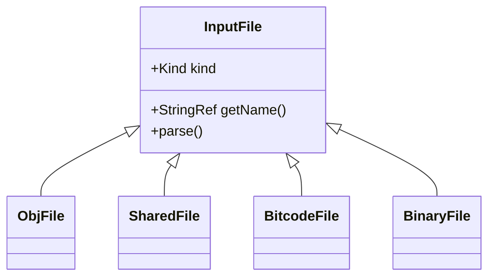

### 3.3 静态库为什么是“按需提取”

静态库 `libfoo.a` 不是一个整体映射进最终程序。它包含多个 archive member，LLD 只在某个成员能够解决当前未定义符号时提取它。

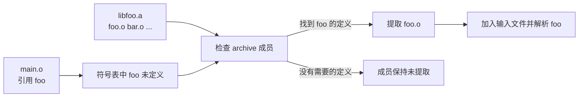

这解释了几个常见行为：

- `-lfoo` 的位置可能影响静态库成员是否被提取；
- `--whole-archive` 会改变按需提取策略；
- `--start-group ... --end-group` 允许多个相互依赖的 archive 反复扫描；
- `-u symbol` / `--undefined=symbol` 可以先制造一个未定义引用，促使 archive 提取成员。

当前 LLD 的 archive 处理和成员解析可以从 `lld/ELF/InputFiles.cpp` 的 archive 逻辑、`lld/ELF/Driver.cpp::LinkerDriver::link` 和 `SymbolTable` 相关代码开始看。

## 4. 符号解析：把名字绑定到定义

### 4.1 符号的基本状态

ELF 符号不只是“有地址”或“没地址”。对学习链接器最有用的几类状态是：

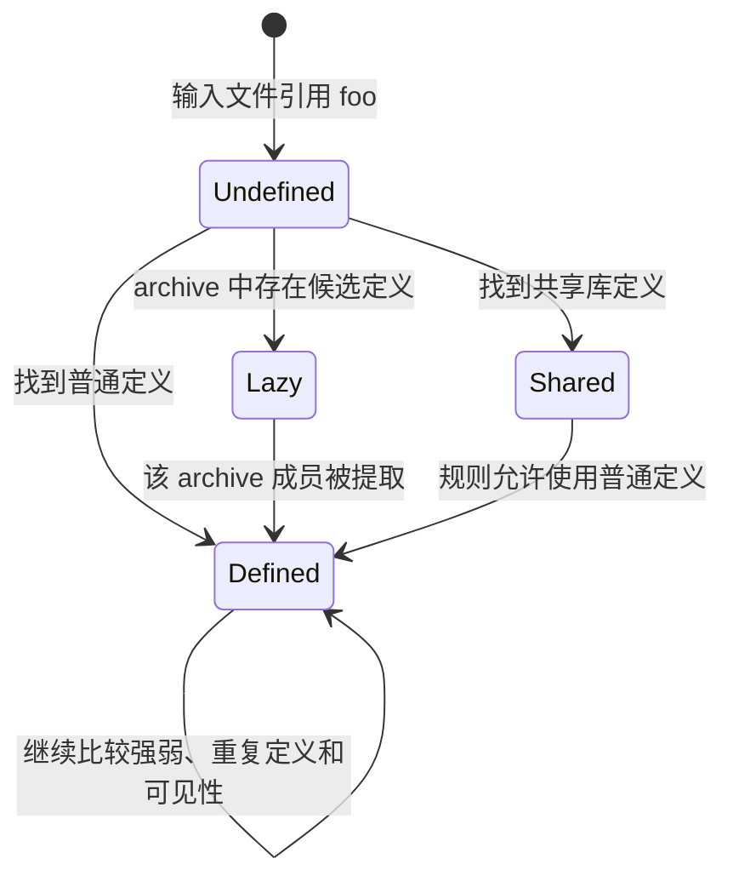

LLD 的 `lld/ELF/Symbols.h` 定义了 `Defined`、`Undefined`、`CommonSymbol`、`SharedSymbol`、`LazySymbol` 等类型；`lld/ELF/SymbolTable.cpp` 维护名字到符号对象的映射。

### 4.2 符号解析的直觉规则

具体规则还受到 binding、visibility、symbol version、共享对象和链接选项影响，但可以先记住：

- 普通定义通常可以解决同名 undefined；
- weak 定义的优先级低于 strong 定义；
- 多个强定义通常产生重复定义错误；
- undefined weak 可以在没有定义时保持为 0 或按目标 ABI 处理；
- archive 中的 lazy symbol 不会自动把整个库拉进来；
- 共享库符号可能具有运行时可抢占（preemptible）属性；
- 对 `--wrap=foo`、版本脚本等选项，LLD 会在普通解析之后继续改写或筛选符号关系。

`Symbol::resolve` 是理解“新符号如何替换当前符号”的重要入口。不要把符号解析和地址分配混在一起：解析阶段先决定“foo 指向哪一个定义”，最终地址要等 section 布局完成后才确定。

### 4.3 一个简单的解析例子

`main.c`：

```c
extern int answer(void);
int main(void) { return answer(); }
```

`answer.c`：

```c
int answer(void) { return 42; }
```

编译后：

```text
main.o:   main  已定义，answer 未定义
answer.o: answer 已定义
```

链接时，LLD 将 `main.o` 中对 `answer` 的引用绑定到 `answer.o` 的定义；但调用指令中的最终位移仍要等 `.text` 的布局和目标架构重定位规则确定后才写入。

## 5. LLVM bitcode 和 LTO 在哪里进入链接

如果输入中有 LLVM bitcode，LLD 不会把它当成普通 ELF `.o` 直接处理。`BitcodeFile` 先参与符号接口和可见性分析，之后 `compileBitcodeFiles` 调用 LTO 组件生成真正的目标文件。

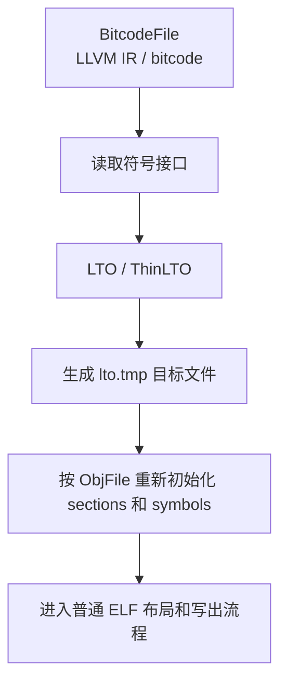

当前源码在 `lld/ELF/Driver.cpp::LinkerDriver::link` 中先处理输入和符号，再调用 `compileBitcodeFiles`；生成的目标文件随后加入普通 object file 流程。这种顺序很重要：LTO 可能改变最终定义、引用和 section 集合，所以最终布局不能在 LTO 之前完全确定。

## 6. section 的收集、裁剪和合并

### 6.1 输入 section 到输出 section

每个 object file 都有自己的 `.text`、`.rodata`、`.data` 等输入 section。LLD 会把它们收集到上下文中，再根据默认规则或 linker script 合并为输出 section。

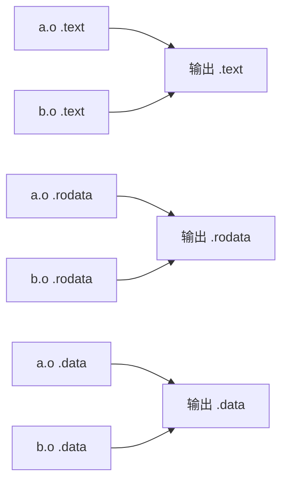

相关对象主要在：

- `lld/ELF/InputSection.h`：输入 section；
- `lld/ELF/OutputSections.h`：输出 section；
- `lld/ELF/LinkerScript.cpp`：section 命令、通配规则和 orphan section；
- `lld/ELF/Driver.cpp`：聚合和调用顺序。

### 6.2 `--gc-sections`：按引用关系删除不可达 section

使用 `-ffunction-sections -fdata-sections` 编译，再用 `-Wl,--gc-sections` 链接时，每个函数或数据对象通常拥有更细粒度的输入 section。LLD 会从入口、保留符号、动态引用、初始化数组等根开始遍历引用关系，把可达 section 标记为 live。

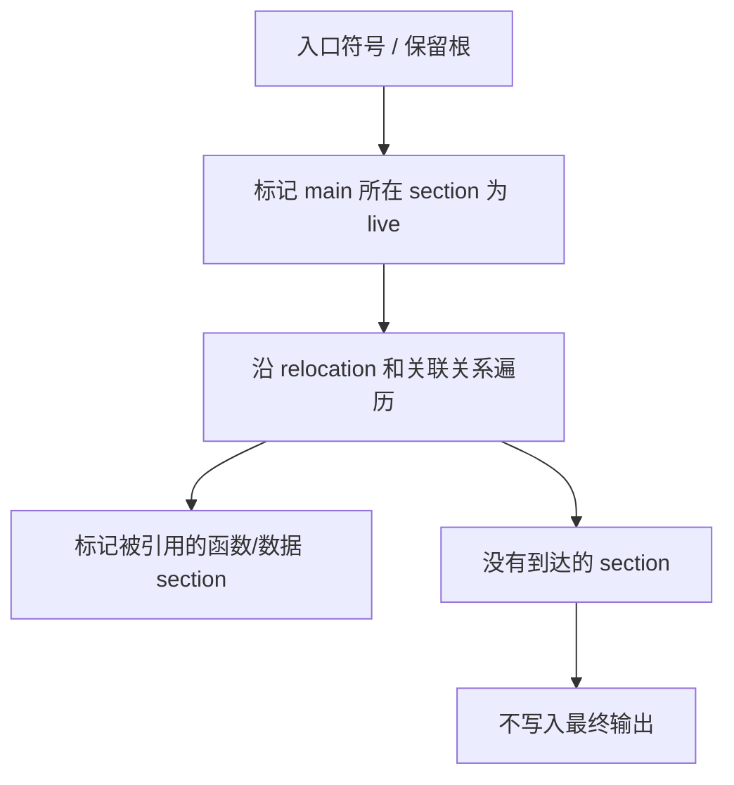

实现入口是 `lld/ELF/MarkLive.cpp::markLive`。没有启用 `--gc-sections` 时，普通输入 section 默认保留；启用后，LLD 才会先清除 live 标记，再从根遍历。

### 6.3 ICF：合并内容相同的函数或数据

`--icf=` 允许 LLD 对满足条件的 section 做 Identical Code Folding。两个函数内容等价时，可以让它们共享一个输出实体，从而减少代码体积。ICF 必须在输出 section 关系已知后进行，并且不能破坏地址和语义要求。

实现主要在 `lld/ELF/ICF.cpp`，调用点在 `lld/ELF/Driver.cpp` 的 section 处理阶段。

## 7. 合成 section：链接器自己创建的内容

输入文件没有提供的内容，LLD 也会根据需要创建，例如：

| 合成 section | 作用 |
|---|---|
| `.got` / `.got.plt` | 保存需要间接寻址的地址槽 |
| `.plt` / `.iplt` | 通过跳板调用动态解析的函数 |
| `.dynsym` / `.dynstr` | 动态加载器使用的符号和字符串 |
| `.rela.dyn` / `.rela.plt` | 动态重定位记录 |
| `.dynamic` | 共享对象、依赖库和动态重定位信息 |
| `.eh_frame` 相关 section | 异常展开和栈回溯信息 |
| `.symtab` / `.strtab` | 静态符号表和字符串表 |

`lld/ELF/SyntheticSections.cpp::createSyntheticSections` 会创建许多合成 section；具体 section 是否出现取决于输出类型、目标架构和选项。

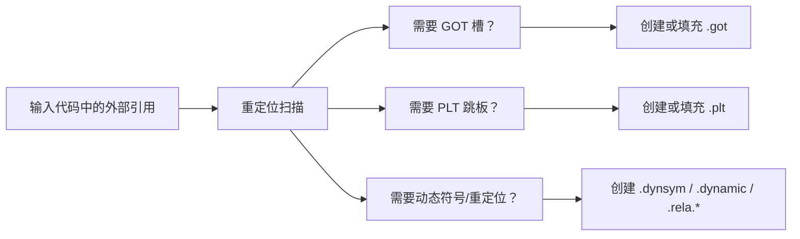

合成 section 不能简单理解为“固定模板”。例如一个完全静态、没有外部动态调用的可执行文件，可能不需要 `.plt`；一个 PIE 或共享对象通常需要更多动态链接元数据。

## 8. 重定位：把占位值改成最终值

### 8.1 重定位记录表达什么

目标文件中的一条重定位通常包含：

- 写入位置 `offset`；
- 重定位类型 `type`；
- 相关符号 `symbol`；
- 加数 `addend`（显式或隐含，取决于 ELF 变体）。

抽象地说，链接器要根据目标架构的规则计算：

```text
写入值 = 函数(符号最终地址、当前位置、addend、重定位类型)
```

不同架构的规则不同，所以 LLD 把目标相关处理放在 `lld/ELF/Target.cpp` 及各目标实现中。

### 8.2 LLD 为什么先扫描重定位

LLD 不一定看到一条重定位就立即写最终字节。扫描阶段可能发现：

- 某个符号需要 GOT 槽；
- 某个函数需要 PLT；
- 某个共享对象引用需要动态重定位；
- 某些 TLS、IFUNC 或 copy relocation 结构必须创建；
- 某个重定位在当前输出类型下无法表示，需要报错或创建 thunk。

因此流程通常是：

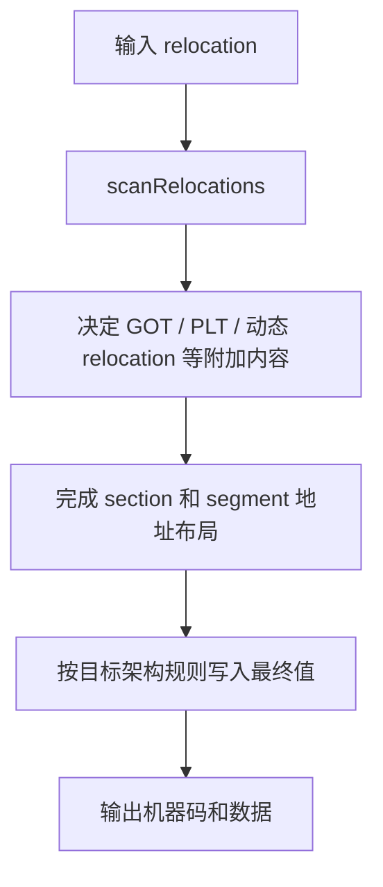

`lld/ELF/Relocations.cpp::scanRelocations` 是重要入口。最终写入通常通过 `InputSection`、目标 `TargetInfo` 和 `relocate` 相关代码完成。

### 8.3 一个 PC-relative 调用的直觉

假设机器指令位于 `P`，目标函数地址为 `S`，指令编码需要一个相对位移，那么链接器可能要写入：

```text
S + A - P
```

其中 `A` 是 addend。具体公式、位宽、溢出范围和是否需要 PLT 完全由目标架构和 relocation type 决定。不要把这个简化公式直接套到所有 ELF relocation 上。

## 9. GOT、PLT 和 Linux 动态加载

### 9.1 为什么需要 GOT/PLT

共享对象加载地址可能在运行前才确定，某个函数最终由哪个 DSO 提供也可能需要动态加载器参与。直接把绝对地址写进所有指令既不灵活，也会增加文本段修改。

一种常见的调用路径是：

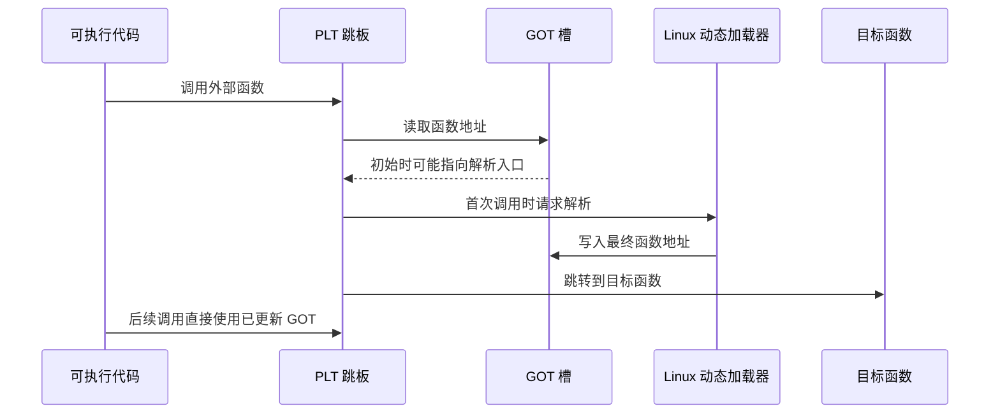

这里的细节会因 `-z now`、`-z lazy`、PIE、符号可抢占性和架构而变化。初学时先记住：**PLT 是代码跳板，GOT 是地址槽，动态加载器负责在运行时填充或修正它们。**

### 9.2 静态链接、动态链接和 PIE 的差别

- 静态链接尽量把库代码复制进输出文件，运行时动态解析较少，但文件可能更大；
- 动态链接把依赖记录写入 `.dynamic` 和 `DT_NEEDED`，由 Linux loader 装载 `.so`；
- PIE 是可执行的 `ET_DYN`，可以整体加载到不同地址，因此需要位置无关代码和相应的动态链接支持。

LLD 负责生成这些 ELF 元数据；它不负责替代 Linux loader 在程序启动时完成全部动态解析。

## 10. linker script 如何改变布局

没有用户 script 时，LLD 使用默认布局规则，把未被显式处理的输入 section 作为 orphan section 分配到合适的输出 section。使用 `-T script.ld` 时，`SECTIONS`、`MEMORY`、符号赋值和 `PHDRS` 等命令会参与布局。

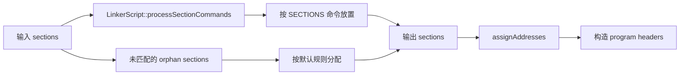

相关入口：

- `lld/ELF/LinkerScript.cpp::processSectionCommands`；
- `LinkerScript::addOrphanSections`；
- `LinkerScript::assignAddresses`；
- `lld/ELF/Writer.cpp::finalizeAddressDependentContent`。

地址布局常常需要多轮调整，因为 section 地址会影响符号值，符号值又会影响重定位、GOT/PLT、segment 大小和对齐。

## 11. Writer 如何写出最终 ELF

`lld/ELF/Writer.cpp::Writer<ELFT>::run` 是理解最终写文件阶段的主入口。可以把它分成以下几步：

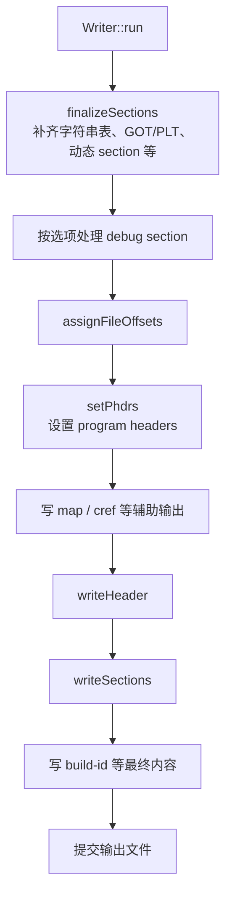

这里有两个容易混淆的点：

1. **地址和文件偏移不是同一个概念**。一个 section 的 `sh_addr` 是运行时地址，一个 section 的文件偏移决定它在 ELF 文件中的位置；`p_offset`、`p_vaddr`、对齐和 segment 映射必须相互一致。
2. **section 内容有些要到很晚才能确定**。例如字符串表大小、动态重定位数量、GOT/PLT 内容、build-id 都可能影响最终布局，因此 Writer 有明确的 finalize 阶段。

最终 ELF 文件一般会包含：

```text
ELF header
program headers（Linux loader 读取）
各个 section 的数据
section headers（链接器和工具读取，某些运行时场景可被剥离）
```

## 12. 错误、诊断和调试链接

### 12.1 未定义符号

常见错误：

```text
undefined reference to `foo'
```

排查顺序：

```bash
llvm-nm -C main.o
llvm-nm -C libfoo.a
readelf -Ws main.o
```

确认：

- 引用是强 undefined 还是 weak undefined；
- 定义是否真的在库中；
- 静态库是否放在引用它的目标文件之后；
- C/C++ 名字修饰是否一致；
- `extern "C"`、符号可见性和版本是否影响匹配。

### 12.2 重定位溢出

重定位溢出通常表示最终地址差值超过目标指令字段能表示的范围，或者代码模型、PIE/非 PIE、目标架构选项不匹配。不要只把它当成“符号没找到”：此时符号可能已经解析成功，但地址无法按该 relocation 类型编码。

### 12.3 有用的 LLD 选项

| 选项 | 用途 |
|---|---|
| `-Map=app.map` | 输出 section、符号和地址布局映射 |
| `--cref` | 输出交叉引用信息 |
| `--trace` | 打印处理过的输入文件 |
| `--trace-symbol=foo` | 跟踪某个符号 |
| `--why-extract=foo` | 解释为什么提取 archive 成员 |
| `--print-gc-sections` | 记录被 `--gc-sections` 删除的 section |
| `--reproduce=dir` | 保存可复现链接所需的输入和响应文件 |
| `--time-trace` | 输出链接阶段时间追踪 |
| `--verbose` / `-Map` | 配合工具观察搜索路径和布局 |

配合 Linux 工具：

```bash
readelf -hW app       # ELF 类型、入口、架构
readelf -lW app       # program headers / segments
readelf -SW app       # section headers
readelf -Ws app       # 符号表
readelf -rW app       # 重定位
readelf -dW app       # 动态 section
llvm-readobj --all app
llvm-nm -C app
objdump -d -r app
```

## 13. 推荐的源码阅读顺序

建议以一个很小的 Linux 程序为实验对象：

```bash
cat > main.c <<'MAIN_C'
extern int answer(void);
int main(void) { return answer(); }
MAIN_C
cat > answer.c <<'ANSWER_C'
int answer(void) { return 42; }
ANSWER_C
clang -c main.c answer.c
clang -fuse-ld=lld main.o answer.o -o app
```

然后按下面顺序阅读：

1. `lld/tools/lld/lld.cpp`：知道 LLD 总入口为什么很薄；
2. `lld/Common/DriverDispatcher.cpp`：理解 `ld.lld` 如何选择 ELF driver；
3. `lld/ELF/Driver.cpp::LinkerDriver::linkerMain`：看参数解析和阶段顺序；
4. `lld/ELF/Driver.cpp::createFiles`、`loadFiles`：看输入文件如何变成内部对象；
5. `lld/ELF/InputFiles.cpp`：看 ELF、archive、共享库和 bitcode 的解析；
6. `lld/ELF/Symbols.h`、`SymbolTable.cpp`：追踪一个符号从 undefined 到 resolved；
7. `lld/ELF/MarkLive.cpp`：理解 section GC；
8. `lld/ELF/SyntheticSections.cpp`：观察 GOT、PLT、dynamic section 如何被创建；
9. `lld/ELF/Relocations.cpp`、`Target.cpp`：追一个 relocation 的扫描和目标相关处理；
10. `lld/ELF/LinkerScript.cpp`：理解输出 section、orphan 和地址分配；
11. `lld/ELF/Writer.cpp::Writer<ELFT>::run`：看最终布局、program headers 和写文件。

### 13.1 用目标文件和最终文件做对比

```bash
clang -S -emit-llvm main.c -o main.ll
clang -c -ffunction-sections -fdata-sections main.c answer.c
readelf -SW main.o
readelf -rW main.o
clang -fuse-ld=lld -Wl,-Map=app.map main.o answer.o -o app
readelf -lW app
readelf -Ws app
```

观察重点：

- `main.o` 中 `answer` 为什么是 undefined；
- `main.o` 的 `.rela.text` 如何描述调用位置；
- 最终 `app` 中 `answer` 获得什么地址；
- 输入 section 如何合并到输出 `.text`；
- 输出 segment 如何覆盖这些 section；
- 如果改成 `-shared` 或 `-fPIE -pie`，`.dynamic`、`.dynsym`、GOT/PLT 有什么变化。

## 14. 三个必须建立的心智模型

### 模型一：符号解析和地址分配是两个阶段

```text
“foo 由 answer.o 定义”       ← 符号解析
“foo 的地址是 0x401126”       ← section 布局完成后才能确定
```

### 模型二：静态库是条件输入

```text
普通 .o：通常直接加入链接
.a：只有能解决未定义引用的成员才会被提取
.so：通常作为动态依赖和符号提供者参与链接
```

### 模型三：链接器和动态加载器分工不同

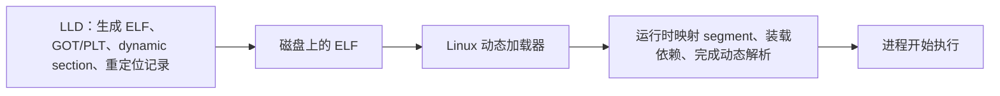

LLD 负责把静态输入组织成一个满足 ELF ABI 的文件；程序启动后，Linux loader 才负责把 segment 映射到内存并处理仍然需要运行时完成的动态重定位。

## 源码速查表

| 想看什么 | 文件或入口 |
|---|---|
| LLD 总入口 | `lld/tools/lld/lld.cpp` |
| 根据 `argv[0]` 选择 flavor | `lld/Common/DriverDispatcher.cpp` |
| ELF 参数解析和阶段总控 | `lld/ELF/Driver.cpp::LinkerDriver::linkerMain` |
| ELF 核心链接流程 | `lld/ELF/Driver.cpp::LinkerDriver::link` |
| 输入文件抽象和解析 | `lld/ELF/InputFiles.h`、`InputFiles.cpp` |
| 符号类型 | `lld/ELF/Symbols.h` |
| 符号表和 resolve | `lld/ELF/SymbolTable.cpp`、`Symbols.cpp` |
| section 聚合和 linker script | `lld/ELF/LinkerScript.cpp` |
| 合成 section | `lld/ELF/SyntheticSections.cpp` |
| 可达性和 `--gc-sections` | `lld/ELF/MarkLive.cpp` |
| ICF | `lld/ELF/ICF.cpp` |
| relocation 扫描 | `lld/ELF/Relocations.cpp::scanRelocations` |
| 目标相关 relocation | `lld/ELF/Target.cpp` 及目标实现 |
| 最终布局和写文件 | `lld/ELF/Writer.cpp::Writer<ELFT>::run` |
| 输入/输出 section 类型 | `lld/ELF/InputSection.h`、`OutputSections.h` |

读 LLD 时，先追一个简单函数调用从 `.o` 到最终地址的路径，再扩展到 archive、共享库、GOT/PLT、LTO 和 linker script。这样每个复杂机制都能落回三个基本问题：**符号是谁提供的、内容放在哪里、最终字节如何写入。**
