# LLVM Sanitizer 实现机制详解（初学者源码导读）

> 适合读者：刚开始学习 LLVM、希望理解 Sanitizer “从命令行到报告”全过程的读者。
>
> 源码基线：`/home/cambricon/Documents/code/llvm-project` 的 `main` 分支（2026-11）。
> 文中路径以该仓库为准；源码行号会随着提交变化，因此优先使用文件名和函数名定位。
> 文中的流程图使用 Mermaid，建议在支持 Mermaid 的 Markdown 阅读器中查看。

## 先看结论

Sanitizer 不是一个单独的检查函数，而是一条由三部分组成的链：

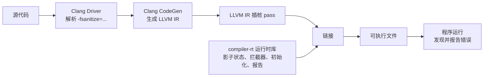

可以把它记成一句话：

> **编译器负责把“检查点”放进程序，运行时负责保存“检查所需的状态”，两者一起发现并解释错误。**

Sanitizer 主要解决五类问题：

| 工具 | 它回答的问题 | 典型错误 |
|---|---|---|
| ASan | 这次内存访问是否落在可访问区域？ | 越界、use-after-free、use-after-return |
| MSan | 这个值是否含有未初始化数据？ | 读取未初始化变量、把未初始化值传给系统调用 |
| TSan | 两次并发访问之间是否缺少 happens-before 关系？ | 数据竞争 |
| UBSan | 这次语言级操作是否违反 C/C++ 语义？ | signed overflow、非法转换、空指针成员访问 |
| HWASan | 指针携带的 tag 是否和内存 tag 相同？ | 越界、use-after-free（硬件辅助） |

Sanitizer 能发现的是**被定义过检查语义、并且在编译或运行时可见的错误**。它不是形式化证明器，也不能保证“没有任何 bug”。

## 1. 用一个最小例子理解整条链

`demo.c`：

```c
#include <stdlib.h>

int main(void) {
  int *p = malloc(sizeof(int));
  free(p);
  return *p;  // use-after-free
}
```

编译并运行：

```bash
clang -O1 -g -fsanitize=address -fno-omit-frame-pointer demo.c -o demo
./demo
```

发生的事情可以分成六步：

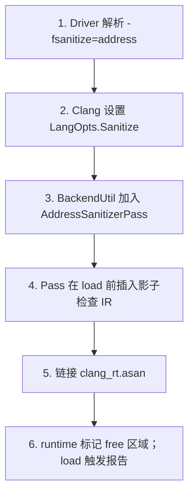

报告中的 `heap-use-after-free` 不是编译器猜出来的。ASan runtime 在 `free` 时把用户区域对应的影子字节改成特定毒性值，访问时读到该值，再结合分配器元数据和栈信息生成报告。

### 1.1 `-fsanitize` 不是只有一个开关

以 `-fsanitize=address` 为例，Driver 主要负责：

- 判断目标平台是否支持该 sanitizer；
- 解析组合选项，例如 `-fsanitize-recover=`、`-fsanitize-trap=`；
- 选择要链接的 `compiler-rt` 库。

Sanitizer 名称和位掩码定义在 `clang/include/clang/Basic/Sanitizers.def`。Driver 的参数解析主要在 `clang/lib/Driver/SanitizerArgs.cpp`。之后，Clang 和 LLVM 大多只检查类似下面的位：

```cpp
LangOpts.Sanitize.has(SanitizerKind::Address)
```

### 1.2 插桩 pass 在流水线中的位置

当前新 Pass Manager 的主要挂载点是 `clang/lib/CodeGen/BackendUtil.cpp` 的 `addSanitizers`。它把 SanitizerCoverage、MSan、TSan、ASan、HWASan 等 pass 加入同一个 sanitizer 回调中；默认注册到 `OptimizerLastEP`，具体构建配置也可以选择 `OptimizerEarlyEP`。

因此不要记成“MSan 永远在 Early、ASan 永远在 Last”。更准确的记法是：

- **ASan** 通常在优化后插桩，减少冗余检查；
- **MSan** 插桩后会在非 `-O0` 下再运行一小段优化，因为它插入了大量影子计算；
- **TSan** 也是 LLVM IR pass，包含 module pass 和 function pass；
- **UBSan** 的大部分检查由 Clang CodeGen 当场生成，少数检查（例如 LLVM 的 bounds checking）由单独的 IR pass 处理。

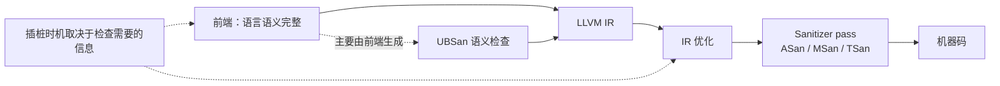

`LowerAllowCheckPass`（`llvm/lib/Transforms/Instrumentation/LowerAllowCheckPass.cpp`）会处理 `llvm.allow.ubsan.check` 等 intrinsic，使检查能够结合 PGO/热点策略被保留或化简。这是“先生成检查，再在优化阶段决定是否保留”的机制，不代表所有 sanitizer 检查都由它完成。

## 2. 插桩的共同形状

很多检查最终都可以抽象成下面的结构：

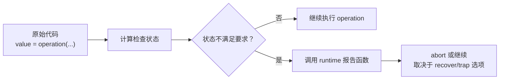

通常分成两条路径：

- **fast path**：移位、加载影子、比较、条件跳转，放在热路径上；
- **slow path**：调用 runtime，收集栈和元数据，生成报告，通常是冷路径。

不同 sanitizer 的关键区别不是“有没有 if”，而是 `state` 的含义：

| 工具 | state 表示什么 | 谁维护它 |
|---|---|---|
| ASan | 地址对应的内存是否可访问 | 分配器、栈/全局插桩、runtime |
| MSan | 一个值的哪些位未初始化 | 每条相关 IR 指令的影子传播 |
| TSan | 最近访问者、访问类型、线程时钟 | runtime 的影子内存和同步状态 |
| UBSan | 当前表达式是否违反规则 | 检查点现场计算 |

这张表是理解后面四章的钥匙。

## 3. ASan：地址的影子内存

### 3.1 影子映射

ASan 把应用地址空间按固定粒度压缩到一块影子内存。常见目标上的核心公式是：

```c
shadow = (address >> 3) + shadow_offset;
```

也就是 **8 个应用字节对应 1 个影子字节**。映射常量和平台布局在 `compiler-rt/lib/asan/asan_mapping.h`。

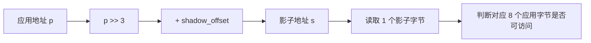

影子字节的基本语义：

```text
0x00       这 8 个字节全部可访问
0x01..0x07 只有前 k 个字节可访问
其它值      poisoned，例如红区、已释放内存、已返回栈帧
```

“前 k 个字节可访问”很重要。比如一块对象末尾只剩 3 个合法字节，影子值可以是 `0x03`。因此小于一个影子粒度的访问，需要进一步检查“最后一个访问字节”是否越过 k；实现位于 `AddressSanitizer::createSlowPathCmp`。

### 3.2 一次 load 如何被检查

概念上的 IR 是：

```llvm
shadow = load i8, ptr ((ptrtoint p >> 3) + __asan_shadow_offset)
bad = shadow != 0
br i1 bad, label %slow, label %continue

slow:
  ; 对部分可访问的尾部区域再比较最后一个字节
  call void @__asan_report_load4(ptrtoint(p))
```

真实代码会根据访问大小、对齐、目标平台和 recover 模式选择不同形态，入口可从 `llvm/lib/Transforms/Instrumentation/AddressSanitizer.cpp` 的 `instrumentAddress` 开始看。

对于非常规大小或对齐的访问，`instrumentUnusualSizeOrAlignment` 会检查访问的首尾字节，并使用带实际大小参数的报告函数。不要把上面的 IR 当成唯一实现，它是帮助理解的简化模型。

### 3.3 谁给影子内存“上毒”和“解毒”

#### 堆内存：分配器和红区

ASan 分配器在用户对象两侧放置 redzone，并在影子中标记它们：

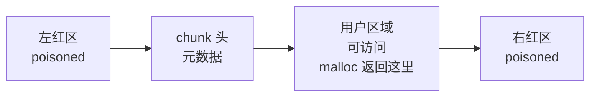

相关注释和实现见 `compiler-rt/lib/asan/asan_allocator.cpp`。调用 `free` 后，用户区域会被标记为已释放状态，并通常进入 quarantine，延迟复用，增加发现 use-after-free 的机会。

#### 栈内存：重排 alloca 并布置红区

`AddressSanitizer.cpp` 中的 `FunctionStackPoisoner` 会为满足条件的栈变量重新布局，并在变量之间、栈帧边界放置红区。函数入口和出口负责相应的 poison/unpoison。启用 use-after-scope 后，变量结束生命周期时还会标记特殊毒性值。

#### 全局变量：module 级处理

module pass 会为可插桩的全局变量布置红区和描述信息，并生成 module constructor 来初始化相应状态。全局变量有许多排除条件（线程局部、特殊链接属性、编译器生成对象等），应以 `shouldInstrumentGlobal` 的当前实现为准。

### 3.4 use-after-return

普通栈帧在函数返回后很快会被复用。开启相应选项时，ASan 可以把部分栈对象放入 fake stack；函数返回后把它们标记为 poisoned，悬空指针再次访问时就能被识别为 `stack-use-after-return`。实现选项来自 `CodeGenOpts.getSanitizeAddressUseAfterReturn()`，运行时行为由 ASan runtime 控制。

### 3.5 报告从哪里来

`__asan_report_loadN`、`__asan_report_storeN` 等函数位于 compiler-rt ASan runtime。报告过程大致是：

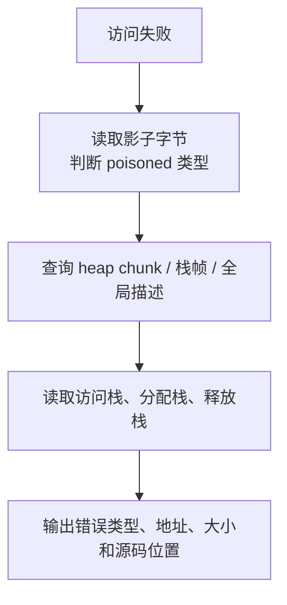

实现主要在 `compiler-rt/lib/asan/asan_report.cpp`。ASan 还会安装信号处理器，使某些没有经过插桩的非法地址访问也能得到更有用的报告；这不等于它能把所有 SIGSEGV 都还原成具体的内存错误。

## 4. MSan：影子跟着值传播

### 4.1 它检查“值”，不是单纯检查“地址”

MSan 使用一块与应用内存直接对应的 shadow。每个应用字节有一个 shadow 字节，shadow 的每一位对应应用值的一位：

```text
应用值 x       = 1010 0001
影子值 shadow(x)= 0000 1100
                 ↑ 某些位的来源未初始化
```

在实际实现中，0 表示 clean，非 0 表示对应位可能未初始化。映射、平台布局和 KMSAN 差异写在 `llvm/lib/Transforms/Instrumentation/MemorySanitizer.cpp` 文件头以及 `compiler-rt/lib/msan/msan.h`。

### 4.2 影子如何传播

编译器为许多 IR 指令维护一份平行的 shadow 值：

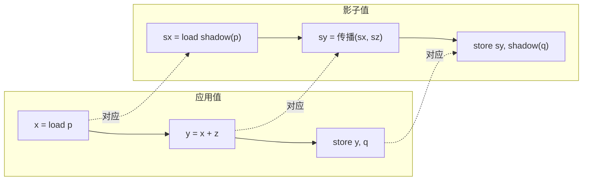

常见规则可以先这样理解：

- 加法、减法、许多浮点/位运算：保守地合并操作数的 shadow；
- `and` 等操作：如果已知某些位必然为 0，可以精确地清掉对应 shadow；
- `phi`：为每条控制流边维护一份 shadow phi；
- 比较：当前实现对整数关系比较做了更精确的区间推理，不是简单的“两个 shadow 直接 OR”。

实现是 `MemorySanitizer.cpp` 中的 `InstVisitor`。阅读时可以从 `handleShadowOr`、`visitAnd`、`handleRelationalComparisonExact`、`visitPHINode` 开始。

### 4.3 什么时候报警

影子传播本身不会打印报告。MSan 会在未初始化值影响可观察行为的位置插入检查，例如：

- 分支条件；
- 返回值和函数参数；
- 系统调用输入；
- 其它会把值交给未插桩代码的边界。

`insertCheckShadow` 会先记录待插入的检查，再在遍历函数后统一生成调用。这解释了一个容易混淆的点：**MSan 不是看到每个非零 shadow 就立刻报警，而是在该值真正被使用到危险位置时报警。**

### 4.4 为什么 MSan 强调全程序

函数参数和返回值可能通过寄存器传递，MSan 使用 `__msan_param_tls` 和 `__msan_retval_tls` 传递相应的 shadow。未插桩的库函数不会维护这套协议，因此普通预编译 libc/libc++ 可能导致漏报或误报。

实际使用时通常需要与 MSan 兼容的系统库和 C++ 库；这比 ASan 的使用门槛高，也是 MSan 更适合专门测试构建的原因。

### 4.5 origin tracking

`-fsanitize-memory-track-origins` 会额外记录未初始化值的来源。origin 是 runtime 管理的 4 字节 ID，每 4 个应用字节对应一个 origin 槽。它能帮助回答“这个脏值最初来自哪次分配或哪条传播路径”，代价是更多内存和运行时间。

## 5. TSan：用 happens-before 识别数据竞争

### 5.1 数据竞争的定义

两个线程访问同一内存位置，至少一次是写，并且两次访问之间没有 happens-before（HB）关系，就可能构成数据竞争。

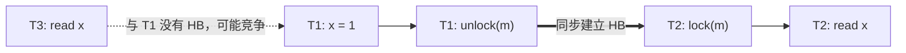

锁、线程创建/连接、条件变量、原子操作的内存序等都会产生同步边。TSan 不是简单地“看到两个线程访问同一地址就报错”。

### 5.2 影子内存保存什么

当前实现中，8 个应用字节映射到一个 shadow cell；每个 cell 有 4 个 `u32` shadow 槽，因此 shadow 总空间约为应用空间的 2 倍。每个槽包含压缩后的访问信息，例如：

```text
线程槽 ID + epoch + 访问字节范围 + 读/写标志 + 原子标志
```

定义见 `compiler-rt/lib/tsan/rtl/tsan_defs.h` 和 `tsan_shadow.h`。这里的 4 个槽不是“4 个线程的完整历史”，而是 runtime 为最近访问记录设计的有限缓存；慢路径会处理更复杂的历史和报告信息。

### 5.3 epoch 和同步

每个线程有自己的逻辑时钟。同步对象会保存参与同步的时钟信息：

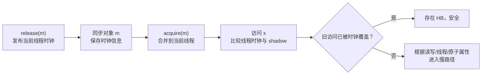

如果旧访问已经被当前线程的时钟覆盖，说明旧访问发生在当前访问之前；否则，TSan 再根据读写属性、线程身份和原子属性判断是否需要进入慢路径报告竞争。

实现细节分布在 `compiler-rt/lib/tsan/rtl/tsan_rtl_access.cpp`、同步对象实现和各类 `__tsan_*` 接口中。epoch 是压缩后的实现细节，不要把它等同于完整的向量时钟本身。

### 5.4 IR 插桩很薄，复杂工作在 runtime

`llvm/lib/Transforms/Instrumentation/ThreadSanitizer.cpp` 通常插入：

- `__tsan_func_entry` / `__tsan_func_exit`；
- `__tsan_readN` / `__tsan_writeN`；
- 未对齐、volatile 等场景对应的访问接口；
- `__tsan_atomic*_load/store/...`。

TSan 把逻辑时钟、影子更新、trace 和报告放到 runtime，因此单次访问的开销通常明显高于 ASan。

注意：C/C++ 的 `volatile` **不等于原子操作，也不自动建立线程同步关系**。TSan 可以为 volatile 访问使用单独的 hook，但真正的原子语义来自 C/C++ 原子操作及其 memory order。

## 6. UBSan：在语言语义还存在时生成检查

### 6.1 为什么主要由 Clang CodeGen 负责

LLVM IR 已经不保留全部 C/C++ 类型语义。比如“这是一次向下转型”“这个成员访问要求指针非空”“这个 enum 值是否有效”，前端比 IR 更清楚。因此许多 UBSan 检查在 Clang CodeGen 阶段生成。

主要入口包括：

- `clang/lib/CodeGen/CGExpr.cpp` 的 `CodeGenFunction::EmitCheck`；
- `clang/lib/CodeGen/CGExprScalar.cpp` 中的算术溢出处理；
- `clang/lib/CodeGen/CodeGenFunction.h` 中的 `TypeCheckKind`。

LLVM 也有少数相关 IR 级检查，例如 `llvm/lib/Transforms/Instrumentation/BoundsChecking.cpp`，所以“UBSan 完全没有 IR pass”是不准确的。

### 6.2 一次 UBSan 检查的形状

```llvm
; 这是简化后的形态
%bad = icmp ...
br i1 %bad, label %handler, label %continue

handler:
  call void @__ubsan_handle_type_mismatch_v1(
      ptr @静态描述数据, i64 %动态值)
```

静态描述数据通常包含源码位置、类型描述和检查种类；动态参数包含指针、数值或索引。`EmitCheck` 还会根据选项决定：

- 默认 handler：报告后继续；
- `-fno-sanitize-recover=`：报告后终止；
- `-fsanitize-trap=`：直接生成 trap，可不链接完整 UBSan runtime。

运行时 handler 主要在 `compiler-rt/lib/ubsan/ubsan_handlers.cpp`。`__ubsan_handle_*` 和 `__ubsan_handle_*_abort` 是常见的一对接口。

## 7. compiler-rt：运行时共同底座

### 7.1 初始化

影子映射、分配器和线程状态必须在插桩代码运行前准备好。以 ASan 为例，初始化通常由 module constructor、运行时构造路径和必要的懒初始化共同保证。入口可从 `compiler-rt/lib/asan/asan_rtl.cpp` 的 `__asan_init` 和 `AsanInitFromRtl` 开始。

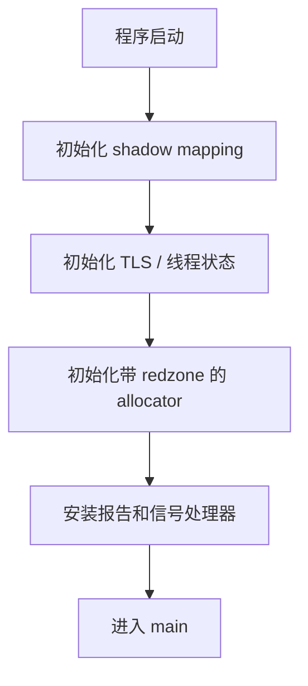

不同平台的启动顺序、动态链接和静态链接细节不同，不应把某一个 ELF 启动路径当成所有平台的规则。

### 7.2 拦截器（interceptor）

编译器看不到未插桩 libc 内部的指针读写，因此 ASan、MSan、TSan 等 runtime 会拦截一部分 `malloc`、`free`、`memcpy`、线程同步和系统接口：

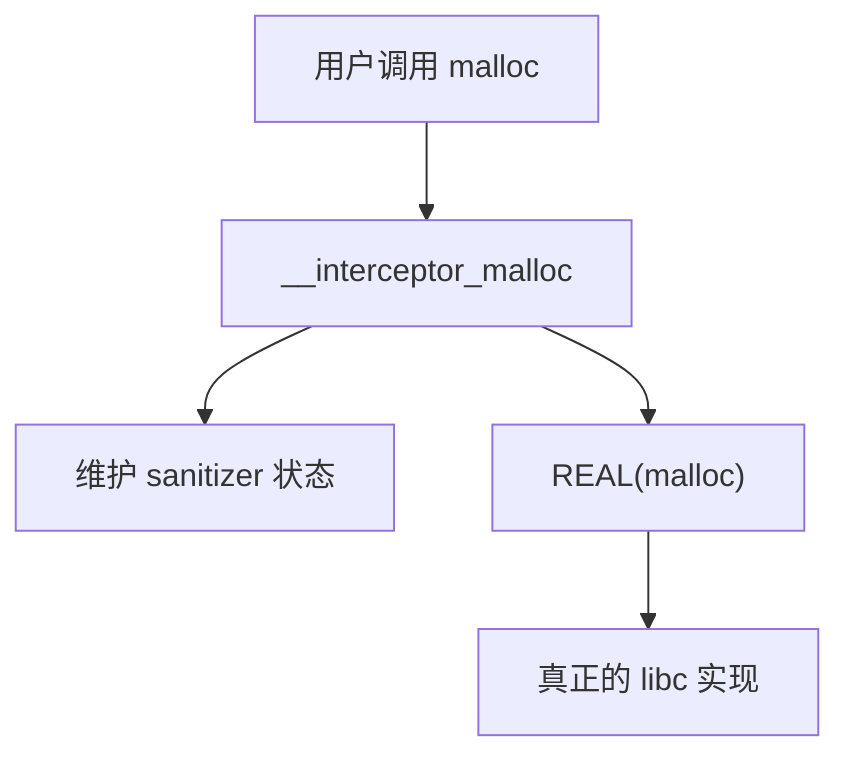

通用模板在 `compiler-rt/lib/sanitizer_common/sanitizer_common_interceptors.inc`，符号抢占和平台适配在 `compiler-rt/lib/interception/interception.h` 及各 sanitizer 的 `*_interceptors.cpp`。不同 sanitizer 拦截的函数集合和处理逻辑并不完全相同。

### 7.3 sanitizer_common

`compiler-rt/lib/sanitizer_common` 提供多个 runtime 共用的基础设施，例如：

- mmap、线程本地存储、互斥和平台封装；
- 栈回溯和符号化；
- 选项解析和报告输出；
- `StackDepot` 等元数据存储。

具体 sanitizer 在此基础上实现自己的影子语义、分配器和报告格式。

## 8. SanitizerCoverage 和 HWASan

### 8.1 SanitizerCoverage：它不负责判断错误

`-fsanitize-coverage=` 插入的是覆盖率反馈，不是越界或数据竞争检查。它记录基本块、边或计数器，供 libFuzzer 等模糊测试器判断一次输入是否探索了新路径。

实现见 `llvm/lib/Transforms/Instrumentation/SanitizerCoverage.cpp`。常见模式包括：

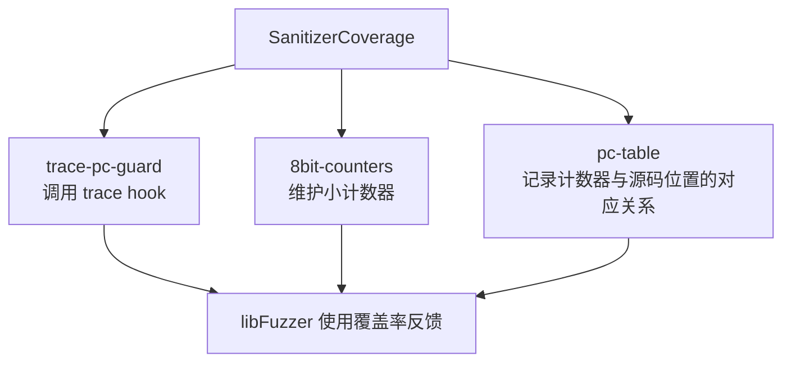

常见组合是：

```bash
-fsanitize=fuzzer,address
```

libFuzzer 负责产生输入和利用覆盖率反馈，ASan 负责发现内存错误。

### 8.2 HWASan：把影子检查换成 tag 检查

HWASan 主要面向支持指针 tag 的目标（典型是 AArch64）：

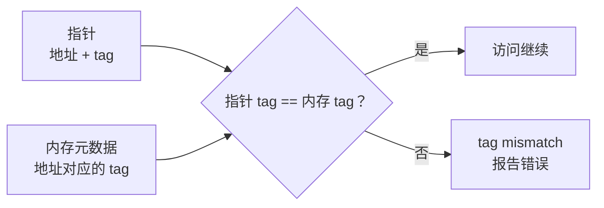

分配对象时选择 tag，并把 tag 放入指针和内存元数据；不匹配时报告错误。它减少了传统 ASan 大型影子映射的压力，但 tag 空间和粒度有限，存在 tag 碰撞带来的漏报可能。实现入口是 `llvm/lib/Transforms/Instrumentation/HWAddressSanitizer.cpp` 和对应 compiler-rt runtime。

## 9. 放在一起比较

| 维度 | ASan | MSan | TSan | UBSan | HWASan |
|---|---|---|---|---|---|
| 检测对象 | 地址可访问性 | 值的初始化状态 | 并发访问的 HB 关系 | 语言级约束 | 地址 tag |
| 主要状态 | 影子字节、redzone | 值影子、可选 origin | 访问槽、epoch、同步时钟 | 检查点参数 | 指针/内存 tag |
| 主要插桩位置 | LLVM IR pass | LLVM IR pass | LLVM IR pass | 主要是 Clang CodeGen | LLVM IR pass |
| 主要运行时工作 | allocator、interceptor、报告 | 影子传播协议、报告 | 时钟、影子、trace、报告 | handler 和符号化 | tag 分配、报告 |
| 是否要求全程序 | 通常不要求，但库边界仍重要 | 基本要求，尤其是 libc/libc++ | 需要插桩的线程和库支持 | 依检查类型而定 | 需要兼容的目标和运行时 |
| 默认错误处理 | 通常终止 | 通常终止 | 通常终止 | 许多检查默认 recover | 通常终止 |
| 主要代价 | 地址空间、运行时间 | 地址空间、运行时间、库构建 | 运行时间和内存较高 | 依检查类型变化 | tag 粒度和碰撞风险 |

不要把网上的“约 2 倍”“5–15 倍”当成固定常数。开销受优化级别、目标架构、运行时选项、程序访问模式和是否启用 origin/coverage 影响，应在自己的程序上测量。

## 10. 建议的学习顺序和实验

### 10.1 推荐顺序

1. 先用 `-fsanitize=address -emit-llvm -S` 看一个简单函数的 IR；
2. 阅读 `BackendUtil.cpp::addSanitizers`，确认 pass 从哪里进入 pipeline；
3. 阅读 `AddressSanitizer.cpp::instrumentAddress`，只追一个 load 的 fast/slow path；
4. 阅读 `asan_mapping.h` 和 `asan_allocator.cpp`，把“影子”和“红区”对应起来；
5. 再看 MSan 的 `getShadow`、`handleShadowOr`、`insertCheckShadow`；
6. 最后看 TSan 的 `__tsan_readN`、`tsan_rtl_access.cpp` 和同步接口；
7. 用 UBSan 对照 `EmitCheck` 和 `ubsan_handlers.cpp`，理解前端检查和 runtime handler 的分工。

### 10.2 一个很有用的观察命令

```bash
clang -O1 -g -fsanitize=address -emit-llvm -S demo.c -o demo.ll
```

在 `demo.ll` 中搜索：

```text
__asan_init
__asan_report_
llvm.lifetime
asan.module_ctor
```

再对比没有 `-fsanitize=address` 的 IR，重点观察：

- load/store 前多了哪些基本块；
- 哪些调用只在错误路径出现；
- 全局 constructor 如何被加入；
- debug location 如何保留。

## 11. 源码速查表

| 想看什么 | 文件或入口 |
|---|---|
| `-fsanitize` 参数解析 | `clang/lib/Driver/SanitizerArgs.cpp` |
| Sanitizer pass 挂载 | `clang/lib/CodeGen/BackendUtil.cpp::addSanitizers` |
| UBSan 检查生成 | `clang/lib/CodeGen/CGExpr.cpp::EmitCheck` |
| ASan IR 插桩 | `llvm/lib/Transforms/Instrumentation/AddressSanitizer.cpp::instrumentAddress` |
| ASan 影子映射 | `compiler-rt/lib/asan/asan_mapping.h` |
| ASan 分配器和红区 | `compiler-rt/lib/asan/asan_allocator.cpp` |
| ASan 初始化和报告 | `compiler-rt/lib/asan/asan_rtl.cpp`、`asan_report.cpp` |
| MSan 设计和传播 | `llvm/lib/Transforms/Instrumentation/MemorySanitizer.cpp` |
| MSan 影子布局 | `compiler-rt/lib/msan/msan.h` |
| TSan IR 插桩 | `llvm/lib/Transforms/Instrumentation/ThreadSanitizer.cpp` |
| TSan 影子编码 | `compiler-rt/lib/tsan/rtl/tsan_defs.h`、`tsan_shadow.h` |
| TSan 访问检查 | `compiler-rt/lib/tsan/rtl/tsan_rtl_access.cpp` |
| UBSan runtime | `compiler-rt/lib/ubsan/ubsan_handlers.cpp` |
| 拦截器框架 | `compiler-rt/lib/interception/interception.h` |
| 通用拦截模板 | `compiler-rt/lib/sanitizer_common/sanitizer_common_interceptors.inc` |
| 覆盖率插桩 | `llvm/lib/Transforms/Instrumentation/SanitizerCoverage.cpp` |
| HWASan 插桩 | `llvm/lib/Transforms/Instrumentation/HWAddressSanitizer.cpp` |

## 最后记住三件事

1. **先问状态是什么**：地址可访问性、值是否初始化、并发时钟，还是语言规则？
2. **再问状态由谁维护**：IR 中的传播、runtime 的分配器，还是同步接口？
3. **最后问检查点在哪里**：前端语义、每次访存、值的危险使用，还是线程事件？

能回答这三个问题，就能读懂大多数 Sanitizer 源码，而不必一开始记住所有 magic number、平台布局和报告函数名。
